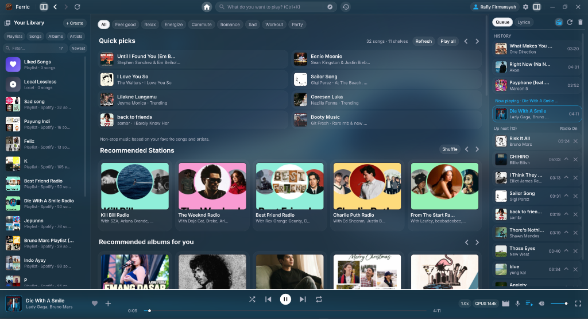
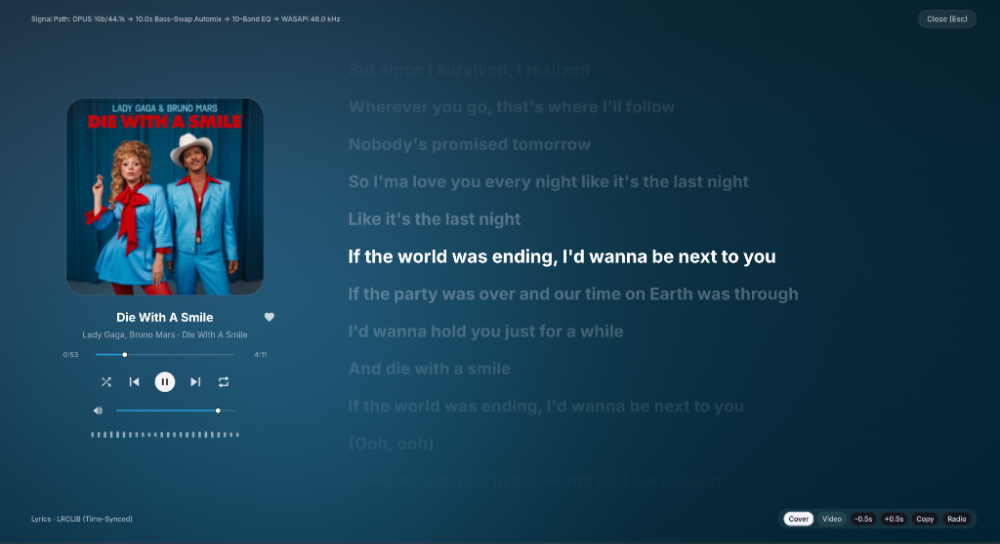
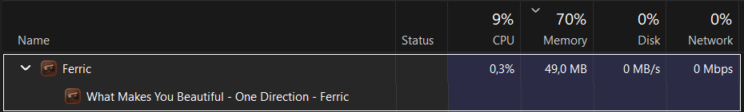
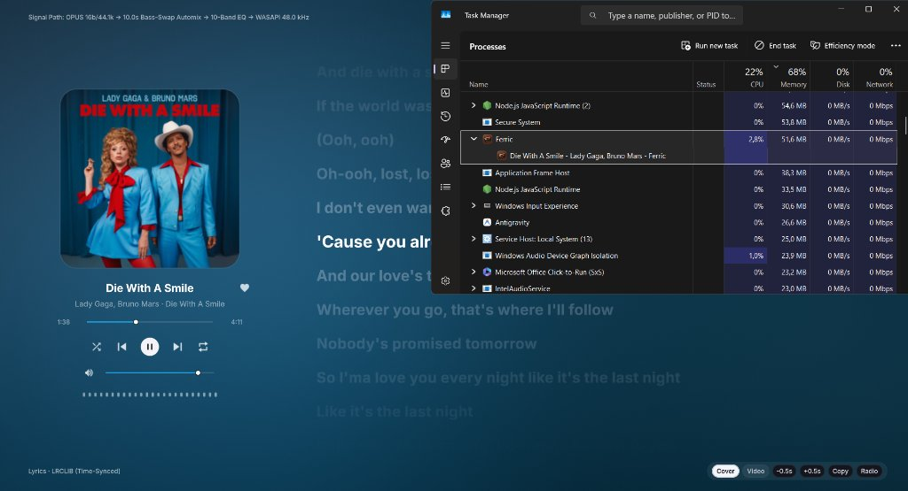
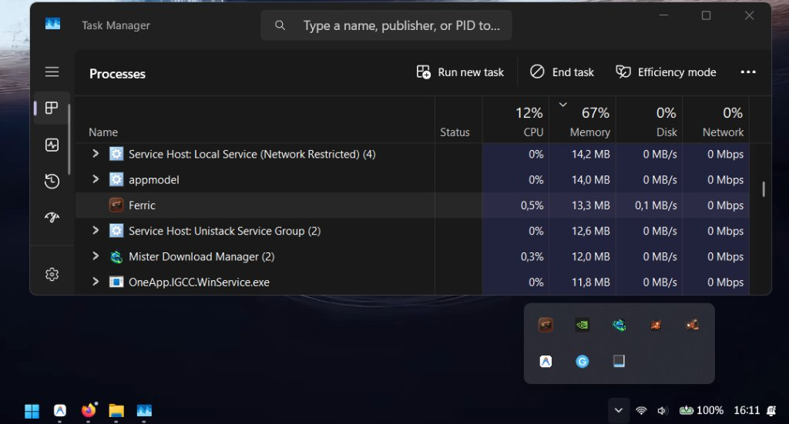

<p align="center">
  
</p>

<h1 align="center">Ferric</h1>
<p align="center"><strong>Native Rust desktop music player for Windows.</strong><br>Sign in and sync your Spotify library (Free &amp; Premium) alongside YouTube Music and local lossless files, with synced lyrics and Windows 11 Acrylic.</p>

<p align="center">
  <a href="https://github.com/Raflyf/Ferric/releases/latest"></a>
  <a href="https://github.com/Raflyf/Ferric/actions/workflows/ci-desktop.yml"></a>
  <a href="LICENSE"></a>
  <a href="https://saweria.co/BuyMatcha"></a>
  <a href="https://yapp.ink/raflyf"></a>
</p>

<p align="center">
  <a href="#download"><strong>Download</strong></a>
  &nbsp;&middot;&nbsp; <a href="https://livelydesk.vercel.app/ferric">Product page</a>
  &nbsp;&middot;&nbsp; <a href="#preview">Preview</a>
  &nbsp;&middot;&nbsp; <a href="#features">Features</a>
  &nbsp;&middot;&nbsp; <a href="#resource-use">Resource use</a>
  &nbsp;&middot;&nbsp; <a href="CHANGELOG.md">Changelog</a>
  &nbsp;&middot;&nbsp; <a href="#code-signing-policy">Code signing policy</a>
  &nbsp;&middot;&nbsp; <a href="#privacy-policy">Privacy policy</a>
</p>

Ferric is a native Windows desktop music player built in Rust with a GPU-accelerated DirectX 11 interface (`makepad-widgets`), a pure-Rust dual-deck audio engine, and a local SQLite library. Sign in directly with your Spotify account (Free or Premium, no Developer Client ID required) to sync your Liked Songs, playlists, and personalized radio stations alongside YouTube Music discovery, OpenSubsonic/Navidrome, and local FLAC/MP3/Opus/AAC collections, with synchronized lyrics and native Windows 11 integration without Electron or a browser shell.

> Windows 10/11 x64. Unsigned per-user installer (no administrator rights required). Native Acrylic backdrop works best on Windows 11. Part of the [LivelyDesk](<https://livelydesk.vercel.app>) desktop suite alongside [WallpaperLive](<https://github.com/Raflyf/WallpaperLive>) and [TransparentBar](<https://github.com/Raflyf/TransparentBar>).

## Preview

<p align="center">
  
</p>

*Desktop workspace (`v0.1.1`): Windows 11 Native Acrylic with Adaptive Acrylic Tint synchronized to the active album cover, synced Spotify playlists, Quick Picks, Recommended Stations, live Queue History / Up Next, and bottom player bar (`1.0x`, `OPUS 144k`).*

<p align="center">
  
</p>

*Fullscreen Synced Lyrics (`v0.1.1`): adaptive cover-colored aurora stage with real-time signal path telemetry (`OPUS 16b/44.1k -> 10.0s Bass-Swap Automix -> 10-Band EQ -> WASAPI 48.0 kHz`), `LRCLIB` time-synced lyrics, timing offset controls (`-0.5s` / `+0.5s`), and docked video clip toggle.*

*Album artwork and track titles shown above belong to their respective owners and are not bundled with the application.*

## Features

- **Two-way Spotify & YouTube Music account sync:** Log in directly inside **Settings > Accounts** with Spotify (Free & Premium, no API key or Client ID required) or YouTube Music to sync your Liked Songs, personal and followed playlists, and Recommended Stations. Playlist creations, edits, renames, deletions, and likes are automatically pushed back to your signed-in account so your library persists across sign-outs and reinstalls. Tokens and cookies are encrypted at rest with Windows DPAPI (`CryptProtectData`).
- **Unified local and online libraries:** Scan local audio folders (`FLAC`, `MP3`, `AAC`/`M4A`, `ALAC`, `Ogg Vorbis`, `Opus`, `WAV`, `AIFF`), browse YouTube Music Home, Search, and Smart Radio, connect OpenSubsonic/Navidrome, sort/deduplicate/filter playlists, save or copy the live Queue, and import public playlist URLs or `.m3u`/`.csv` files.
- **Pure-Rust dual-deck audio engine & live WASAPI output switching:** Gapless album playback, configurable auto-crossfade (`0-12 s`) with 140 Hz Bass-Swap Automix, S-Curve Velvet, and Equal-Power curves, live WASAPI output device selector and hot-swap in **Settings > Playback**, 10-band parametric Biquad EQ with 24 built-in AutoEq profiles and Equalizer APO `.txt` import/export, ReplayGain, Mono downmix, Sleep Timer, and one-click bottom-bar Playback Speed (`0.75x` / `1.0x` / `1.25x` / `1.5x`).
- **Synced lyrics, Fullscreen Lyrics, and docked video clips:** 4-stage lyrics waterfall (local `.lrc` sidecar, embedded tags, `LRCLIB`, `Lyrics.ovh`), timing offset controls (`-0.5s` / `+0.5s`), Fullscreen Lyrics aurora stage, and optional docked HD music video clips.
- **Four themes with Windows 11 Acrylic and adaptive cover colors:** Switch between `AMOLED Black` (default), `Native Acrylic`, `Obsidian Studio`, and `Warm Cream Light`. Customize glass opacity and tint with a GPU HSV picker, or let Adaptive Artwork Accent and Adaptive Acrylic Tint harmonize automatically with the playing cover while maintaining WCAG AA contrast.
- **Native Windows 11 integration:** Full Windows SMTC metadata, cover art, live timeline position, and seek support for Quick Settings and third-party overlays (Nusa Pro, NotchPixel, ModernFlyouts), plus taskbar thumbnail buttons (`Prev` / `Play-Pause` / `Next`) and a device-theme-aware dark/light system tray menu.
- **Low-overhead GPU and tray residency:** Prefers the integrated GPU on hybrid laptops so discrete GPUs stay asleep, releases CPU cover buffers after GPU upload, skips paused idle redraws, uses zero-allocation filtering/sorting, and trims working set when minimized to the system tray.
- **Optional Discord Rich Presence and Ferric Connect:** Zero-dependency local Discord IPC (`Listening to Ferric`) with an optional `Listen on Spotify / YouTube Music` button, plus LAN QR pairing discovery (active only while the Connect tab is open).
- **Local credential protection and clean uninstall:** Stored tokens, cookies, and passwords are encrypted with Windows DPAPI (`CryptProtectData`); full MSI uninstallation removes `%LOCALAPPDATA%\LivelyDesk\Ferric` and app residue while upgrades preserve your database and settings.

## Resource use

| State | Memory (Task Manager / PrivWS) | CPU | Disk / GPU notes |
| :--- | ---: | ---: | :--- |
| UI open, idle (10 s after launch) | 6.0 MB | 0.0% | `0.0%` GPU, iGPU only (`0` dGPU DLLs loaded) |
| Active streaming playback, UI open | 49.0 MB | 0.3% | `0 MB/s` Disk, `0 Mbps` steady after buffer (`35.5 - 49.5 MB` across switches) |
| Fullscreen Synced Lyrics active | 51.6 MB | 2.8% | `0 MB/s` Disk, live ambient aurora shader + real-time visualizer on iGPU |
| Minimized to system tray, playing | 13.3 MB | 0.5% | `0.0%` GPU, working set trimmed automatically (`6.5 - 17.1 MB` across switches) |

<p align="center">
  
</p>

*Windows Task Manager (`v0.1.1`): active streaming playback with desktop UI open (`0.3%` CPU, `49.0 MB` memory, `0 MB/s` disk).*

<table>
  <tr>
    <td width="50%" align="center">
      
      <br><sub><strong>Fullscreen Synced Lyrics + visualizer:</strong> <code>2.8%</code> CPU · <code>51.6 MB</code> memory</sub>
    </td>
    <td width="50%" align="center">
      
      <br><sub><strong>Minimized to system tray, playing:</strong> <code>0.5%</code> CPU · <code>13.3 MB</code> memory</sub>
    </td>
  </tr>
</table>

*Observed on the author's Windows 11 laptop (`x86_64`, Intel iGPU + hybrid dGPU), not fixed ceilings or guarantees. Memory, CPU, and GPU vary with display scaling, graphics driver, library size, streaming codec, and whether Fullscreen Lyrics or video clips are active.*

## Download

| Package | Best for |
| :--- | :--- |
| [Windows installer (`ferricsetup-v0.1.3.msi`)](<https://github.com/Raflyf/Ferric/releases/latest/download/ferricsetup-v0.1.3.msi>) | Per-user Windows installation, Start Menu shortcut (`AppUserModelID`), and clean root-level uninstall |
| [Portable ZIP (`Ferric-v0.1.3-windows-x86_64.zip`)](<https://github.com/Raflyf/Ferric/releases/latest/download/Ferric-v0.1.3-windows-x86_64.zip>) | Running on Windows without installation |
| Android APK (`ferric-v0.1.0-android-arm64-v8a.apk` / `universal`) | Android 9+ initial release (`arm64-v8a` / universal) via [Android CI builds](<.github/workflows/ci-android.yml>) or manual APK install |
| [SHA-256 checksums (`SHA256SUMS.txt`)](<https://github.com/Raflyf/Ferric/releases/latest/download/SHA256SUMS.txt>) | Verifying installer and portable archive integrity before running |

**Requirements:** Windows 10 or Windows 11 on a 64-bit (`x86_64`) PC (no administrator rights required; native Windows Acrylic backdrop works best on Windows 11), or Android 9+ (API 28+).

Browse [all releases](<https://github.com/Raflyf/Ferric/releases>) &middot; [LivelyDesk showcase](<https://livelydesk.vercel.app/ferric>) &middot; [LivelyDesk User Guide](<https://livelydesk.vercel.app/doc#ferric-install>) &middot; [Report an issue](<https://github.com/Raflyf/Ferric/issues>)

## Getting started

1. Download the MSI installer or extract the portable ZIP, and verify its hash against `SHA256SUMS.txt`.
2. Launch Ferric. Open **Settings > Accounts** to sign in with your **Spotify (Free & Premium)** account and press **Sync Library** to sync your Liked Songs and playlists (or optionally connect YouTube Music or OpenSubsonic/Navidrome), and add local music folders under **Settings > Storage**.
3. Open **Settings > Appearance** to switch between `AMOLED Black`, `Native Acrylic`, `Obsidian Studio`, and `Warm Cream Light`, adjust UI zoom (`Ctrl -` / `Ctrl +` / `Ctrl 0`), or tune Acrylic opacity and glass tint.
4. Useful shortcuts: `Space` (play/pause), `Shift+Left` / `Shift+Right` (previous/next track), `M` (mute), `S` (shuffle), `R` (repeat), `L` (like/unlike current track), `Ctrl+L` (lyrics panel), `F` (fullscreen lyrics), `Ctrl+K` (command palette), `Ctrl+Shift+C` (copy song link), `Esc` (close overlay).

## Building from source

<details>
<summary>Windows MSVC toolchain and release build commands</summary>

Requires Rust stable (`x86_64-pc-windows-msvc`), Visual Studio C++ build tools, Windows SDK, and Python 3 (for PE hardening verification).

```powershell
rustup default stable-x86_64-pc-windows-msvc
cargo fmt --all -- --check
cargo clippy --workspace --all-targets --locked -- -D warnings
cargo test --workspace --locked
powershell -NoProfile -ExecutionPolicy Bypass -File .\scripts\build-release.ps1
python .\scripts\verify_pe_hardening.py .\target\release\ferric.exe
powershell -NoProfile -ExecutionPolicy Bypass -File .\scripts\Installer.ps1
```

</details>

## Support

Optional support via [Buy me a coffee](<https://yapp.ink/raflyf>) or [Saweria](<https://saweria.co/BuyMatcha>). Ferric is free and open source; donations never gate or unlock features.

## Code signing policy

Ferric releases (including `v0.1.3`) are currently **unsigned** (no Authenticode code-signing certificate is active). Windows Defender SmartScreen may show an unknown-publisher warning on new releases. All official installers, portable archives, and `SHA256SUMS.txt` manifests are compiled transparently from public source via [GitHub Actions](<.github/workflows/release.yml>). Always download from [GitHub Releases](<https://github.com/Raflyf/Ferric/releases>), verify SHA-256 digests before installing, and keep Windows security protections enabled.

## Privacy policy

Ferric does not collect, store, or transmit analytics, crash telemetry, or local library paths to developer servers. Your SQLite database, settings, cached artwork, and stream cache stay locally under `%LOCALAPPDATA%\LivelyDesk\Ferric`, and saved account tokens, cookies, and passwords are encrypted at rest with Windows DPAPI (`CryptProtectData`).

Network connections are limited to the following endpoints:

- **Update check (startup, opt-out in Settings > About):** Sends one read-only HTTPS `GET` to `api.github.com/repos/Raflyf/Ferric/releases/latest` (`User-Agent: Ferric/<version>`). Updates download only after you click **Update Now** from `github.com` / `objects.githubusercontent.com` / `release-assets.githubusercontent.com` and verify against `SHA256SUMS.txt`.
- **Home discovery & artwork (startup and browsing):** Loads YouTube Music shelves and recommendations from `music.youtube.com` and cover thumbnails from `*.googleusercontent.com`, `*.ggpht.com`, and `i.ytimg.com`. When signed in to Spotify, Recommended Stations also query `clienttoken.spotify.com` and `api-partner.spotify.com` (with `open.spotify.com` / `open.spotifycdn.com` on query hash refresh) and load covers from `*.scdn.co` / `*.spotifycdn.com`.
- **Playback, video clips & lyrics (on play):** Online playback resolves streams via `www.youtube.com` and streams audio/video from `*.googlevideo.com`. When no local `.lrc` file or embedded tag is present, lyrics are queried from `lrclib.net` with `api.lyrics.ovh` as fallback.
- **Optional accounts & integrations (user action only):** Sign-in, library sync, and user-initiated playlist or liked-song edits contact `accounts.google.com`, `accounts.spotify.com`, `api.spotify.com`, `music.youtube.com`, or your user-configured OpenSubsonic/Navidrome server. Optional Discord Rich Presence communicates locally over `\\.\pipe\discord-ipc-0..9` (passing Ferric's public icon URL on `raw.githubusercontent.com` and optional Spotify / YouTube Music track link buttons in the Discord activity payload). When Ferric Connect is enabled, LAN discovery uses UDP port `43821` and optional Cloud Relay links your signed-in Spotify/YouTube Music devices.

## License

[MIT](LICENSE) &copy; Rafly Firmansyah.
