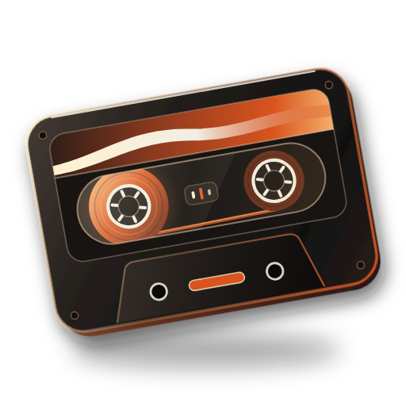

<p align="center">
  
</p>

# Ferric (`v0.1.0`)

Ultra-lightweight, 100% native Rust cross-platform Hi-Fi music player targeting **Windows 10/11** (Desktop first in `v0.1.0`) and **Android 8–16+**.

Part of the **LivelyDesk** visual product family (`LivelyDesk` · `WallpaperLive` · `TransparentBar` · `Ferric`), built with strict 3-color Pure AMOLED Pitch Black (`#000000`, `#F3EEE3` Warm Cream, `#D9541E` Burnt Orange) as default, unlimited **Open Theme Studio** customization, and an optional GPU-accelerated **Liquid Glass** SDF optical refraction shader toggle.

## Highlights (`v0.1.0` Desktop Preview)

- **Native Rust UI (`makepad-widgets 1.0.0`, DX11):** Zero Electron, zero WebView, low RAM/CPU/GPU footprint.
- **Pure-Rust Audiophile Audio Engine (`ferric-audio`):**
  - Multi-format decoding via `symphonia 0.6.1` + pure-Rust `symphonia-opus 0.1.3` (FLAC, MP3, AAC/M4A, ALAC, Ogg Vorbis, Opus, WAV, AIFF).
  - Lock-free SPSC audio pipeline (`rtrb` -> `cpal` WASAPI) with `rubato 5.1.0` resampling, gapless/equal-power crossfade, live **10-band Parametric EQ (`biquad`)** + **Equalizer APO `.txt` import/export**, and soft-clip limiter.
- **Persistent SQLite WAL Library (`ferric-core` + `ferric-providers`):**
  - Fast local folder scanning (`lofty` metadata reader), instant search (`Ctrl+K`), True Smart Shuffle (Fisher-Yates with artist spacing), and synced `.lrc` lyrics (`LRCLIB` + local `.lrc`).
  - Clean-room *Metadata-Audio Decoupling* foundation (`AudioResolver` trait + `yt_metadata_cleaner` + official OAuth 2.0 PKCE config for Spotify & YouTube/YT Music — zero DRM circumvention).
- **Open Theme Studio & Liquid Glass Toggle:**
  - Strict 3-color Pure AMOLED default (`0%` GPU idle).
  - Live **Liquid Glass Theme (`OFF` / `ON`)** toggle with real-time Makepad GPU SDF refraction, chromatic edge dispersion, specular rim catchlight, readability scrim, WCAG contrast guard, and `.ferric-theme.json` import/export.
- **Windows Integration:** Native embedded `ferric.ico` icon, native Windows folder/file picker (`rfd`), and hardware media keys / Windows 11 SMTC flyout (`souvlaki`).

## Workspace Layout

```text
ferric/
├── Cargo.toml                  # Workspace manifest (v0.1.0, LTO + strip release profile)
├── apps/
│   └── ferric-desktop/         # Windows native Makepad 1.0 GUI + SMTC + embedded ferric.ico
├── crates/
│   ├── ferric-core/            # SQLite WAL store, queue/smart shuffle, Theme/Liquid Glass, EQ APO parser
│   ├── ferric-audio/           # Dual-deck Symphonia + Opus + Rubato + 10-band Biquad EQ + rtrb + cpal
│   ├── ferric-providers/       # Local scanner (lofty), yt_metadata_cleaner, LRCLIB .lrc, AudioResolver
│   └── ferric-sync/            # Ferric Connect binary postcard framing, QR pairing URI, Active Speaker Lease
├── assets/
│   ├── brand/                  # ferric.svg, ferric.png, ferric.ico, wordmarks, monochrome glyph
│   └── ui_previews/            # Liquid Glass mode UI visual previews
└── docs/                       # PRD.md, DESIGN.md, SYNC_AND_AUDIO_SPEC.md, RESEARCH_AND_RE_FINDINGS.md
```

## Build Locally (Windows MSVC)

```powershell
rustup default stable-x86_64-pc-windows-msvc
cargo test --workspace
cargo build --release -p ferric-desktop
```

## Automated CI Builds

Every push to `main` runs formatting, Clippy (`-D warnings`), workspace unit tests, and packages a downloadable **`Ferric-v0.1.0-windows-x86_64.zip`** artifact in GitHub Actions (without creating a release tag until reviewed).
