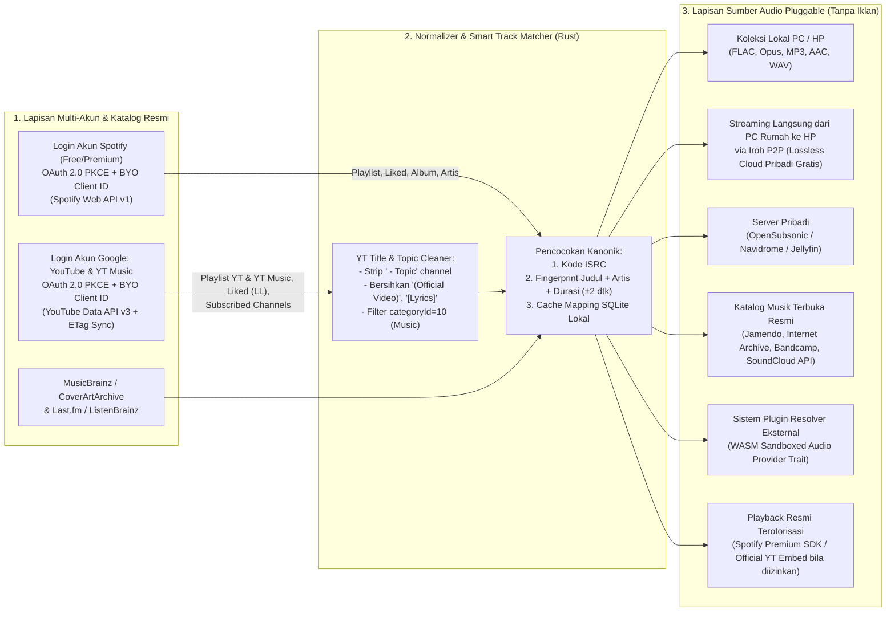
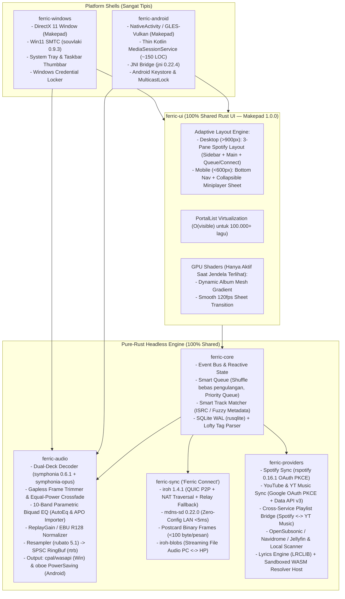

# Product Requirements Document (PRD): Aplikasi Pemutar Musik Lintas Platform Full Native Rust (Codename: **Ferric**)

- **Versi Dokumen:** 1.1.0 (Updated: Multi-Account Spotify + YouTube / YouTube Music)
- **Tanggal:** 24 November 2026
- **Target Platform:** Windows 10/11 (`x86_64`, `aarch64`) & Android 8.0–16+ (`arm64-v8a`, `armeabi-v7a`, `x86_64`)
- **Bahasa Pemrograman Utama:** 100% Native Rust (Edition 2024, Rust 1.85+) + Thin Android JNI Service (~150 baris Kotlin khusus syarat wajib OS Android `MediaSessionService`)
- **Referensi Analisis:** [RESEARCH_AND_RE_FINDINGS.md](file:///d:/code/project/music%20player/RESEARCH_AND_RE_FINDINGS.md) & [SYNC_AND_AUDIO_SPEC.md](file:///d:/code/project/music%20player/SYNC_AND_AUDIO_SPEC.md)

---

## 1. Visi Produk & Tujuan Utama

Membangun aplikasi pemutar dan pengelola musik modern sekelas Spotify & YouTube Music yang **100% gratis, bebas iklan di dalam aplikasi, seluruh fitur pemutaran terbuka penuh** (*unlimited skips*, bebas pilih lagu spesifik kapan saja, *on-demand queue*, lirik sinkron kata-per-kata, *offline mode*, *parametric equalizer*, *cross-service playlist sync*, dan *cross-device remote control*), namun ditulis menggunakan **Full Native Rust** agar memiliki jejak penggunaan **RAM, CPU, GPU, dan baterai paling ringan di kelasnya** baik di PC Windows maupun HP Android.

Keunggulan utama dibanding aplikasi referensi (`Sonora v0.50.3` di Windows dan `Auralys v4.1.0 / Metrolist` di Android) adalah:
1. **Satu Inti Kode Native Rust untuk Windows + Android** (mengatasi keterbatasan `GPUI` pada Sonora yang tidak bisa jalan di Android, dan mengatasi beban memori JVM/Compose/ExoPlayer pada Auralys di Android).
2. **Multi-Account Login Terpadu (Spotify + YouTube / YouTube Music Sekaligus):** Pengguna dapat login menggunakan akun **Spotify (Free/Premium)**, akun **Google untuk YouTube & YouTube Music (Free/Premium)**, keduanya secara bersamaan, atau tanpa akun sama sekali (*offline-first*).
3. **Fitur "Ferric Connect" (Bidirectional Desktop <-> Mobile Sync Tanpa Server Pusat):** Memutar musik di PC Windows dapat dikontrol penuh secara real-time dari HP Android (play/pause, seek, ganti lagu, atur volume, ubah antrean, lempar output suara dari PC ke HP atau sebaliknya), bekerja otomatis di Wi-Fi lokal (`mDNS`) maupun jarak jauh lewat internet seluler (`iroh` P2P QUIC).
4. **Arsitektur Legal & Tahan Banting (*Metadata-Audio Decoupling*):** Mendukung login resmi ke ekosistem Spotify dan YouTube / YouTube Music tanpa bergantung pada pembobolan DRM, *QuickJS cipher scraping*, atau pemalsuan token anti-bot yang melanggar hukum dan mudah rusak.

---

## 2. Batasan Kepatuhan, Keamanan, & Strategi "Multi-Akun (Spotify + YT Music) Gratis Tanpa Iklan"

> [!IMPORTANT]
> **Prinsip Arsitektur Legal (*Zero DRM & Anti-Bot Circumvention*):**
> Proyek ini **tidak menyalin kode proprietary**, **tidak membobol enkripsi DRM (Widevine/PlayReady)**, **tidak memalsukan token internal klien Spotify (`clienttoken`)**, **tidak membajak endpoint internal `youtubei/v1/player` maupun memecahkan cipher tanda tangan dengan `QuickJS` (`yt.solver.core.js`)**, **tidak melewati gerbang anti-bot (`po_token`)**, serta **tidak memodifikasi/menghapus iklan dari stream audio/video terproteksi milik server Spotify maupun YouTube**. Pendekatan tidak resmi tersebut melanggar hukum hak cipta/anti-circumvention, memicu pemblokiran akun Google/Spotify, membengkakkan ukuran aplikasi dengan engine JS tambahan, dan terus-menerus rusak setiap kali platform memperbarui proteksinya.

### Bagaimana Cara Mewujudkan "Login Akun Spotify & YouTube/YT Music (Free & Premium), Semua Fitur Terbuka, Tanpa Iklan" Secara Legal & Permanen?

Kita menerapkan arsitektur **Unified Metadata-Audio Decoupling** (pola arsitektur terbuka yang menyatukan **Katalog Multi-Akun Resmi** dan memisahkannya dari **Resolver Audio**):



**Mengapa desain ini jauh lebih unggul?**
1. **Satu Login Google Mencakup YouTube Sekaligus YouTube Music:** Secara arsitektur backend Google, **YouTube dan YouTube Music memakai akun dan database playlist yang sama**. Dengan **Google OAuth 2.0 PKCE + YouTube Data API v3** (`youtube.readonly` / `youtube.force-ssl`), pengguna otomatis mendapatkan seluruh playlist YouTube Music, playlist YouTube reguler, *Liked Songs/Videos* (playlist sistem `LL`), dan channel musisi yang di-subscribe (termasuk channel otomatis `Artis - Topic` milik YouTube Music), baik pada akun **Free maupun YouTube Premium**.
2. **Akun Free (Spotify maupun YouTube) Tidak Dibatasi di Lapisan Aplikasi Kita:** Pembatasan akun Free (iklan, larangan *background play* saat layar HP mati di aplikasi YouTube gratis, atau paksaan *shuffle* di Spotify mobile gratis) hanya mengikat pemutar stream milik platform tersebut. Karena pemutaran audio ditangani oleh engine native Rust kita dari sumber audio pilihan pengguna (file lokal, streaming P2P dari PC rumah, server Navidrome/Jellyfin, katalog bebas royalti, atau plugin resolver eksternal WASM), maka **layar mati (*background play*), *on-demand play*, *unlimited skip*, *gapless/crossfade*, *offline cache*, dan *10-band EQ* terbuka 100% tanpa iklan**.
3. **Lebih Ringan Tanpa Beban `QuickJS`:** Dengan menggunakan REST JSON murni **YouTube Data API v3** alih-alih membajak `innertube`, aplikasi kita **tidak perlu mengemas `libquickjs.so` (~925 KB) + skrip JS pemecah cipher (`yt.solver.core.js` ~530 KB) + WebView `po_token.html`** seperti yang ada di dalam Auralys dan Sonora.
4. **Anti-Blokir Kuota API (*BYO Client ID + ETag Caching*):** Mendukung *Client ID* pribadi pengguna baik untuk Spotify Developer maupun Google Cloud Console (10.000 unit gratis/hari; pembacaan `playlists.list`, `playlistItems.list`, dan batch 50 lagu di `videos.list` masing-masing hanya memakan **1 unit**, ditambah *short-circuit* header `If-None-Match: <ETag>` yang menghasilkan `304 Not Modified` tanpa mengunduh ulang!).

---

## 3. Target Performa & Efisiensi Sumber Daya (Non-Functional Requirements)

Setiap keputusan arsitektur wajib tunduk pada anggaran efisiensi berikut:

| Metrik | Target Windows 10/11 (x64/ARM64) | Target Android 8–16 (ARM64) | Strategi Teknis Pencapaian |
| :--- | :--- | :--- | :--- |
| **Ukuran File Aplikasi** | **< 12 MB** (`.exe` tunggal) | **< 15 MB** (`.apk` per ABI) | LTO penuh (`lto = "fat"`), `strip = "symbols"`, `opt-level = "z"` untuk modul non-DSP, 1 set ikon SVG terkompresi, tanpa bundling Chromium/WebView atau kamus 33 MB. |
| **RAM Saat Idle / Pause** | **18 – 30 MB** | **20 – 35 MB** | SQLite dengan `mmap` terbatas, cache gambar sampul menggunakan format terkompresi / ukuran tepat sasaran (mis. thumbnail `128x128` RGBA = 64 KB per sampul, dibatasi LRU maksimal 64 item = maksimal 4 MB VRAM/RAM!). |
| **RAM Saat Memutar (UI Terbuka)** | **28 – 48 MB** | **30 – 50 MB** | Streaming chunked buffer (`rtrb` 250–500 ms PCM = < 400 KB RAM; tidak pernah mendekompresi utuh seluruh file FLAC/MP3 ke RAM). |
| **RAM Saat Diminimize / Layar HP Mati** | **15 – 25 MB** | **12 – 20 MB** | **Zero-Surface Background Mode:** Menghancurkan seluruh tekstur sampul non-aktif & melepas GPU swapchain saat jendela diminimize (`WM_SIZE`) atau Activity Android masuk `onStop()`. |
| **CPU Saat Memutar Audio** | **< 0,5% – 1,2%** pada 1 core modern | **< 1,0% – 2,0%** (offload DSP hardware) | Decoder pure-Rust bebas alokasi (`symphonia 0.6.1` + `symphonia-opus`) + Android `oboe` dengan `PerformanceMode::PowerSaving` (buffer besar hardware DSP). |
| **GPU Saat Tidak Ada Input/Animasi** | **0,0%** | **0,0%** | *Event-driven reactive rendering* (`Makepad 1.0`): frame GPU hanya digambar ulang jika ada event input, perubahan lirik aktif, atau progres bar yang terlihat di layar (progres bar di-update 4–10 Hz jika tanpa animasi gelombang, bukan 120 Hz terus-menerus!). |
| **Waktu Cold Start** | **< 180 ms** sampai jendela siap | **< 250 ms** sampai layar utama tampil | Inisialisasi jaringan & pemindaian folder dijalankan asinkron setelah frame UI pertama muncul dari snapshot SQLite terakhir. |

---

## 4. Arsitektur Sistem & Pemilihan Tech Stack (Full Native Rust)

### 4.1 Diagram Arsitektur Workspace Cargo



### 4.2 Daftar Crate Utama yang Dikunci

| Kategori | Crate | Versi | Fungsi Spesifik |
| :--- | :--- | :--- | :--- |
| **UI Lintas Platform** | `makepad-widgets` | `1.0.0` | Rendering UI native GPU (DX11 di Windows, Vulkan/GLES di Android), lisensi MIT/Apache-2.0. *(Alternatif jika ingin markup deklaratif GPLv3: `slint 1.19.0`)* |
| **Async Runtime** | `tokio` | `1.54+` | Runtime I/O jaringan & task background (dikonfigurasi hemat thread: 2 worker thread). |
| **Audio Demux/Decode** | `symphonia` + `symphonia-opus` | `0.6.1` + `0.1` | Decoding murni Rust untuk FLAC, MP3, AAC, ALAC, WAV, Vorbis, dan Opus tanpa C NDK. |
| **Audio Resampling** | `rubato` | `5.1.0` | Konversi *sample rate* presisi tinggi (mis. 44.1 kHz ke 48 kHz mixer OS). |
| **Audio DSP / EQ** | `biquad` + `realfft` | `0.4` + `3.5` | Filter *peaking/low-shelf/high-shelf* 10-band Parametric EQ & spektrum opsional. |
| **Lock-Free Audio Buf** | `rtrb` | `0.3.1` | *Wait-free* SPSC ring buffer antara thread decoder dan thread hardware audio. |
| **Audio Out (Win)** | `cpal` + `wasapi` | `0.18.2` + `0.27.0` | WASAPI Shared standar + opsi WASAPI Exclusive bit-perfect. |
| **Audio Out (Android)** | `oboe` | `0.6.1` | Android AAudio dengan `PerformanceMode::PowerSaving` & `Usage::Media`. |
| **Sync & P2P Network** | `iroh` + `iroh-blobs` + `mdns-sd` | `1.4.1` + `0.22.0` | Penemuan perangkat LAN instan + sinkronisasi/streaming jarak jauh lintas internet tanpa server. |
| **Serialisasi Protokol** | `postcard` + `serde` | `1.1` + `1.0` | Serialisasi biner super ringkas untuk pesan kontrol sinkronisasi (<100 byte). |
| **OAuth Spotify & Google/YT** | `rspotify` + `oauth2` + `reqwest` | `0.16.1` + `5.0` + `0.13` | OAuth 2.0 PKCE resmi untuk **Spotify Web API** dan **Google / YouTube Data API v3** (menggunakan klien REST `reqwest` bertipe ringan ~250 baris tanpa crate codegen berat `google-youtube3`). |
| **Normalisasi Judul YT** | `aho-corasick` | `1.1+` | Pembersih super cepat tanpa regex berat untuk mengurai judul YouTube (`Artis - Topic`, `(Official Video)`, `[Lyrics]`) menjadi metadata lagu kanonik. |
| **Database & Tag** | `rusqlite` + `lofty` | `0.43+` + `0.25+` | Penyimpanan lokal SQLite mode WAL + pembaca metadata/cover art lokal. |
| **Media OS & Keystore** | `souvlaki` + `keyring` + `jni` | `0.9.3` + `3.x` + `0.22.4` | Tombol media Windows SMTC, penyimpanan token aman di Credential Manager / Android Keystore. |

---

## 5. Spesifikasi Fitur Lengkap (Functional Requirements)

### 5.1 Autentikasi Multi-Akun: Spotify + YouTube & YouTube Music (Tier Free & Premium)
1. **Login Akun Spotify (Free & Premium) via OAuth 2.0 PKCE:**
   - Login resmi melalui browser sistem (`accounts.spotify.com/authorize`) dengan *loopback redirect* di Windows (`http://127.0.0.1:<port>/callback`) dan *App Link / Custom URI Scheme* di Android (`ferric://auth/spotify`).
   - Sinkronisasi inkremental dua arah untuk *Playlists*, *Liked Songs*, *Saved Albums*, dan *Followed Artists* berbasis `snapshot_id`.
2. **Login Akun Google untuk YouTube & YouTube Music (Free & Premium) via OAuth 2.0 PKCE:**
   - Satu kali login akun Google otomatis membuka akses ke pustaka **YouTube reguler sekaligus YouTube Music** menggunakan **YouTube Data API v3**:
     - **Windows Desktop:** Klien OAuth tipe *Desktop App* dengan PKCE loopback (`http://127.0.0.1:<port>/oauth2/google`).
     - **Android Native:** Klien OAuth tipe *Android* (terikat package name & SHA-1 sertifikat aplikasi, redirect URI `com.googleusercontent.apps.<id>:/oauth2redirect` melalui Android Custom Tabs).
     - **Scope Minimal & Aman:** Default `https://www.googleapis.com/auth/youtube.readonly` (hanya baca) atau `https://www.googleapis.com/auth/youtube.force-ssl` bila pengguna mengaktifkan fitur tulis/edit playlist & tombol Like.
   - **Sinkronisasi Katalog YouTube Music & YouTube Hemat Kuota:**
     - Mengambil seluruh *Playlists* pengguna (`playlists.list`), *Liked Songs / Videos* melalui ID playlist sistem **`LL`**, serta daftar musisi/channel yang di-subscribe (`subscriptions.list`).
     - Menyimpan header **`ETag`** setiap playlist di SQLite dan mengirim `If-None-Match` saat sinkronisasi berikutnya — jika bernilai `304 Not Modified`, aplikasi melewati unduhan item sehingga menghemat kuota harian 10.000 unit hampir 100%.
     - **Filter Khusus Musik (`videoCategoryId = 10`):** Memeriksa detail batch 50 video sekaligus (`videos.list` = hanya 1 unit kuota) dengan opsi filter pintar *"Hanya Tampilkan Kategori Musik (`categoryId == 10`)"* agar video vlog/gaming dari akun YouTube reguler tidak mengotori pustaka musik pengguna (namun tetap bisa dimatikan jika pengguna suka memutar podcast/cover non-kategori 10).
   - **YouTube Music Smart Metadata Cleaner:**
     - Mendeteksi channel otomatis YouTube Music (`<Nama Artis> - Topic`) untuk mengekstrak nama artis asli secara akurat, memotong label bising seperti `(Official Music Video)`, `(Official Audio)`, `[Lyric Video]`, `(Visualizer)`, dan mencocokkannya ke database `ISRC`/MusicBrainz agar lirik (`LRCLIB`) dan sumber audio lossless tetap presisi.
3. **Jembatan Sinkronisasi Lintas Layanan (*Spotify <-> YouTube Music Bridge*):**
   - Pengguna dapat login ke **kedua akun sekaligus** dalam satu aplikasi, menggabungkan tampilan *Liked Songs*, serta melakukan **Migrasi 1-Klik atau Auto-Mirror Playlist** dari Spotify ke YouTube Music maupun dari YouTube Music ke Spotify.
4. **Mode Tanpa Akun (*Local / Offline-First*) & Keamanan Token:**
   - Aplikasi tetap berjalan 100% tanpa login akun apa pun. Seluruh *refresh token* Spotify dan Google disimpan terenkripsi di Windows Credential Locker / Android Keystore (tidak pernah meminta password mentah).

### 5.2 Pemutaran Audio Kelas Audiophile & Semua Fitur Terbuka
1. **Kontrol Penuh Tanpa Batasan Tier:**
   - Klik lagu mana saja langsung putar (*on-demand*), *unlimited skip* maju/mundur, *scrubbing* instan di titik mana pun, ulangi satu lagu (*Repeat One*), ulangi antrean (*Repeat All*), dan *True Smart Shuffle* (menggunakan algoritma *Fisher-Yates dengan Artist-Spacing* agar lagu dari artis yang sama tidak menumpuk berurutan seperti keluhan klasik shuffle Spotify).
2. **True Gapless Playback & Equal-Power Crossfade:**
   - Dua slot decoder aktif (`Deck A` dan `Deck B`). `Deck B` melakukan *pre-buffering* 8 detik sebelum `Deck A` selesai.
   - Memotong *encoder delay* dan *padding* pada file MP3/AAC/Opus sehingga album live atau konsep (seperti Pink Floyd / transisi DJ mix) menyambung 0 milidetik tanpa bunyi klik/jeda.
   - Opsi *Crossfade* mulus yang dapat diatur dari `0` hingga `12 detik` (otomatis dinonaktifkan bila mendeteksi dua lagu berurutan berasal dari album yang sama dan pengguna mengaktifkan opsi *"Album-Aware Crossfade"*!).
3. **10-Band Parametric Equalizer + Import AutoEq & Equalizer APO (Inspirasi Terbaik Sonora + Auralys):**
   - Mendukung filter Biquad `Peaking`, `LowShelf`, `HighShelf`, `LowPass`, `HighPass` dengan pengaturan *Preamp* dan pencegah kliping (*Soft Limiter*).
   - **AutoEq 1-Click Search (dari Auralys):** Cari model TWS/headphone (ribuan profil headphone) dan terapkan kurva koreksinya dalam 1 klik.
   - **Import/Export `.txt` Equalizer APO (dari Sonora):** Pengguna desktop audiophile dapat langsung memuat konfigurasi Equalizer APO mereka, dan konfigurasi EQ tersebut **ikut tersinkronisasi ke HP Android**!
4. **Loudness Normalization (ReplayGain / EBU R128) & Silence Trimmer:**
   - Menyamakan kekerasan suara antar-lagu dari sumber berbeda tanpa merusak dinamika, ditambah fitur opsional pemotong bagian hening di awal/akhir lagu (*Trim Silence* dari Sonora).

### 5.3 Fitur Utama Unggulan: "Ferric Connect" (Sinkronisasi & Kontrol Silang Desktop <-> HP)
Fitur ini menjawab kebutuhan utama kontrol bolak-balik PC Windows dan HP Android seperti Spotify Connect, namun bekerja untuk **semua pengguna (termasuk akun Free maupun tanpa akun Spotify)**:

1. **Pairing Sekali Seumur Hidup (Tanpa Buat Akun Server):**
   - Saat PC dan HP berada di Wi-Fi yang sama, keduanya otomatis muncul di menu **"Perangkat Tersedia"** dalam <1 detik via `mdns-sd`.
   - Untuk pairing permanen lintas jaringan (agar HP pakai kuota 4G/5G tetap terhubung ke PC di rumah), cukup **Scan QR Code** di layar PC dari HP Android. QR berisi `EndpointId` publik Ed25519 + token otorisasi bersama.
2. **Kontrol Real-Time Dua Arah (<20 ms di LAN, <80 ms via Internet):**
   - Menyalakan lagu di PC -> di HP langsung muncul bar *"Sedang Memutar di Desktop-PC"* lengkap dengan sampul album, progres detik yang bergerak mulus, lirik yang ikut berjalan, tombol Play/Pause, Next/Prev, Seek, Shuffle/Repeat, **Slider Volume PC**, dan **Editor Antrean (Queue)** langsung dari HP!
   - Sebaliknya, saat HP sedang memutar lagu (misal terhubung ke speaker Bluetooth atau TWS) -> dari PC Windows pengguna bisa mengontrol lagu, antrean, dan volume HP!
3. **Instant Output Handoff ("Pindahkan Suara ke Sini"):**
   - Satu klik tombol **"Putar di HP Ini"** saat musik sedang menyala di PC akan memindahkan *Active Speaker Lease* dari PC ke HP pada milidetik dan posisi lagu yang sama persis (*seamless handoff*), sambil otomatis mem-pause output audio PC.
4. **Bonus Fitur Killer — "Personal Home Cloud Streaming" (PC sebagai Server Musik Pribadi untuk HP):**
   - Punya 50 GB koleksi lagu FLAC/MP3 di hardisk PC Windows tapi memori HP penuh? Selama PC menyala, HP Android dapat memutar atau mengunduh lagu lokal yang ada di hardisk PC secara langsung dari mana saja lewat tunnel P2P `iroh-blobs` (dengan opsi *On-the-Fly Opus 160kbps Transcoding* agar hemat kuota seluler saat di luar rumah!).
5. **Mode "Listen Together" Sinkron (Inspirasi Auralys, namun P2P):**
   - Selain mode *1 Active Speaker + Remote Control*, pengguna bisa mengaktifkan mode **Simulcast (Nyalakan Bareng)** di mana PC dan HP (atau bersama perangkat teman lewat tautan undangan `iroh`) memutar suara secara bersamaan dengan kompensasi offset jam presisi (*Buffer-Ready Barrier*).

### 5.4 Lirik, Offline Caching, & Integrasi Ekosistem
1. **Synced Lyrics Ringan Tanpa Kamus 33 MB:**
   - Mengambil lirik berwaktu (*line-synced* `.lrc` & *word/syllable-synced* `.elrc`/TTML) dari `LRCLIB` dan file `.lrc` lokal, lalu menyimpannya di SQLite agar tetap tampil saat offline.
   - Romanisasi lirik Jepang/Korea/Mandarin dibuat sebagai **modul unduhan opsional (*on-demand language pack*)** atau menggunakan tabel transliterasi ringan (<500 KB), menghindarkan APK dari pembengkakan 33,4 MB kamus Kuromoji seperti di Auralys.
2. **Smart Offline Cache & Kuota Penyimpanan Otomatis:**
   - Pengguna dapat mengatur batas cache (misal `512 MB`, `2 GB`, `5 GB`) atau menandai Playlist sebagai *"Tersedia Offline"* (untuk sumber lokal, P2P PC, Subsonic/Jellyfin, dan sumber terbuka yang mengizinkan unduhan). Pembersihan otomatis berbasis LRU (*Least Recently Played*).
3. **Integrasi Ekosistem Tambahan:**
   - **Discord Rich Presence** (di Windows, dengan tombol toggle hemat daya) dan **Last.fm / ListenBrainz Scrobbling** (antrean offline: jika sedang tidak ada internet, riwayat putar disimpan di SQLite dan dikirim saat online kembali).
   - **SponsorBlock / Non-Music Segment Skipper** opsional untuk sumber yang memiliki segmen intro/percakapan panjang di luar musik.

---

## 6. Saran Peningkatan (*Improvements*) Fungsi, Logika, & Cara Kerja di Atas Sonora & Auralys

Berikut adalah daftar inovasi teknis dan logika produk yang dirancang khusus agar aplikasi kita melampaui Spotify resmi, Sonora, maupun Auralys:

1. **Zero-GPU Background Teardown (*Battery & RAM Saver Mode*):**
   - **Masalah di aplikasi lain:** Spotify Desktop (Chromium CEF) memakan 350–700 MB RAM bahkan saat diminimize ke tray; banyak aplikasi mobile tetap menahan puluhan megabyte tekstur sampul album di VRAM saat layar HP mati.
   - **Solusi kita:** Begitu jendela Windows di-minimize ke System Tray atau Activity Android masuk status `onStop()`, `ferric-ui` memanggil `evict_all_gpu_textures_except_notification_thumb()` dan menghentikan loop render sepenuhnya. Hasilnya: penggunaan GPU menjadi **mutlak 0,0%** dan RAM turun ke kisaran **12–20 MB** tanpa menghentikan musik sedikit pun.
2. **Adaptive Progress Tick Rate:**
   - Saat jendela terlihat tapi hanya menampilkan bar progres biasa, UI hanya me-redraw area *seekbar* setiap `250 ms` (4 FPS) atau ketika pixel lebar bar benar-benar bertambah >= 1 piksel! Mode 60/120 FPS hanya aktif saat pengguna sedang melakukan *scroll*, membuka transisi *sheet*, melihat lirik *word-by-word*, atau menyalakan *spectrum visualizer*. Ini memangkas penggunaan CPU/GPU saat layar menyala hingga **90%**.
3. **Pre-Decoded Next-Track PCM Warmth + Network Stall Recovery:**
   - Thread decoder memantau kecepatan jaringan. Jika koneksi melambat, aplikasi menyimpan *ring buffer* terkompresi di disk sementara (bukan di RAM!) untuk lagu berikutnya sehingga transisi lagu tetap instan tanpa membebani RAM.
4. **ISRC & Cross-Catalog Hybrid Resolution Cache:**
   - Saat menyinkronkan playlist Spotify maupun YouTube / YouTube Music, aplikasi menyatukan identitas lagu (`spotify_id` <-> `youtube_video_id` <-> `isrc`) di SQLite. Begitu lagu berhasil dipetakan ke file FLAC lokal di PC, server Navidrome, atau resolver eksternal, pemetaan tersebut di-cache secara lokal sehingga pemutaran kedua dan seterusnya memerlukan **0 request pencarian API** (mulai berbunyi dalam <30 ms!).
5. **Sinkronisasi Katalog Akun via P2P (`One-Login Device Share`):**
   - Setelah pengguna login ke Spotify dan YouTube Music di PC Windows, katalog playlist yang sudah tersinkronisasi di SQLite PC langsung dapat diakses dan dicerminkan ke HP Android yang ter-pair lewat `Ferric Connect` (`iroh`), menghemat kuota API harian dan mempercepat setup di perangkat kedua dalam hitungan detik.
6. **Per-Output Audio Profile Otomatis:**
   - Aplikasi mengingat profil EQ dan volume berbeda berdasarkan perangkat output yang aktif! Misalnya: saat TWS Bluetooth tersambung ke HP, otomatis aktifkan profil *AutoEq TWS A*; saat dicolok ke speaker kamar atau DAC USB di PC, otomatis pindah ke profil *Flat / Speaker EQ*.
7. **Smart Local-to-Mobile Sync ("Pin Playlist dari PC ke HP"):**
   - Pengguna cukup klik kanan playlist (baik playlist lokal, Spotify, maupun YouTube Music yang sudah terpetakan) di PC -> *"Sync ke HP Android"*. Lewat jaringan Wi-Fi lokal (`iroh-blobs`), ratusan lagu langsung ditransfer berkecepatan tinggi (50–100 MB/detik di Wi-Fi 6) dengan konversi otomatis opsional dari FLAC besar menjadi **Opus 160 kbps** (kualitas transparan setara CD dengan ukuran 80% lebih kecil) oleh decoder/encoder Rust di PC sebelum dikirim ke HP!
8. **Unified Command Palette (`Ctrl+K` di Windows):**
   - Terinspirasi dari kecepatan editor Zed/Raycast: tekan `Ctrl+K` di Windows untuk langsung mencari lagu lintas akun (Spotify + YouTube Music + Lokal), mengganti output perangkat ("Pindahkan ke HP Galaxy"), mengganti preset EQ, menyalin playlist antar-akun, atau mengatur *Sleep Timer* dalam hitungan milidetik tanpa menyentuh mouse.

---

## 7. Desain UI/UX, Identitas Default 3 Warna, & Open Theme Studio

Spesifikasi sistem visual lengkap tersimpan di [DESIGN.md](file:///d:/code/project/music%20player/DESIGN.md) dan file desain live [ferric-ui-ux.figcraft](file:///d:/code/project/music%20player/ferric-ui-ux.figcraft).

- **Identitas Visual Default (Ketat 3 Warna):** Pure OLED Pitch Black (`#000000` / `#111111` Ink Charcoal), Warm Cream (`#F3EEE3`), dan Burnt Orange (`#D9541E`) sebagai satu-satunya aksen kromatik. Seluruh badge sumber (`Spotify`, `YT Music`, `Local FLAC`, `P2P`) menggunakan monokrom hangat tanpa palet warna-warni berlebih.
- **Open Appearance Studio (Kustomisasi Bebas Tanpa Batas):** Pengguna dapat mengubah secara bebas setiap token warna (HSV/HEX + Opacity), memakai gambar latar kustom / Windows Mica-Acrylic translucency + blur, memilih font sistem atau mengimpor `.ttf`/`.otf`, mengatur *Corner Radius* (`0–24px`), *Row Density* (`36–72px`), posisi sidebar, gaya player bar, mengekspor/mengimpor tema `.ferric-theme.json`, serta menyinkronkan tema kustom langsung antara PC dan Android via *Ferric Connect*.
- **Toggle Tema `Liquid Glass` (`OFF` Default / `ON` Opsional di Seluruh UI/UX):** Saklar ON/OFF di `Settings > Appearance` (Desktop & Android) yang mengaktifkan **Makepad SDF Optical Liquid Glass Fragment Shader** (HLSL DX11 di Windows, GLSL ES/Vulkan di Android) pada seluruh elemen mengambang — sidebar rail, top search bar, floating bottom player dock, always-on-top mini-player widget, panel Connect/EQ, Android Now Playing transport deck, Android floating mini-player & bottom nav capsule, serta Command Palette `Ctrl+K`. Dilengkapi kontrol real-time `IOR`, `Chromatic Edge Dispersion (0–100%)`, `Frost Blur`, `Bevel Radius`, `Specular Rim`, dan `WCAG Readability Scrim`, dengan *dirty-frame-only rendering* (`0%` GPU saat statis) serta *auto-fallback* ke AMOLED solid saat diminimalkan, layar terkunci, atau *Battery Saver* aktif.
- **Ikon Produk Resmi (Terkunci):** **Ferric Oxide Cassette** ([ferric.svg](file:///d:/code/project/music%20player/assets/brand/ferric.svg), [ferric.png](file:///d:/code/project/music%20player/assets/brand/ferric.png), [ferric.ico](file:///d:/code/project/music%20player/assets/brand/ferric.ico)) — kaset pita magnetik *Type-I* 3D berbezel tembaga tanpa huruf yang seragam dengan lini `LivelyDesk`, `WallpaperLive`, dan `TransparentBar`.

Satu codebase UI `ferric-ui` (`Makepad 1.0.0`) beradaptasi secara otomatis berdasarkan ukuran viewport dan jenis input (Mouse/Keyboard vs Sentuhan):

- **Mode Desktop Windows (`>= 900px`):**
  - **Custom Frameless Titlebar** ringan dengan kontrol jendela native Windows 11 (*Snap Layouts* tetap berfungsi penuh).
  - **Sidebar Kiri:** Navigasi (Home, Search, Library), filter cepat (Playlists, Liked, Local, Perangkat PC/HP), dan daftar Playlist tervirtualisasi.
  - **Panel Tengah:** Konten utama (Daftar lagu `PortalList` dengan kolom nomor, judul, album, sumber audio `LOCAL`/`P2P`/`SUBSONIC`/`PLUGIN`, durasi).
  - **Panel Kanan (Collapsible):** Bergantian menampilkan Antrean (*Queue*), Lirik Sinkron, atau Panel **Ferric Connect** (daftar perangkat terhubung & volume masing-masing).
  - **Bottom Player Bar:** Kontrol pemutaran, seekbar, tombol Lirik, tombol EQ, tombol **Connect Device Picker**, dan slider volume.
  - **Miniplayer Mengambang (*Compact PIP Mode*):** Ukuran kecil `320x96 px` opsional di pojok layar dengan RAM < 22 MB.
- **Mode Mobile Android (`< 600px`):**
  - Menghormati *Android Safe Area Insets* (cutout kamera & gesture navigation bar transparan *edge-to-edge*).
  - **Floating Miniplayer** di atas **Bottom Navigation Bar** (Home, Search, Library, Connect).
  - Geser ke atas (*Swipe-up*) pada Miniplayer membuka layar **Now Playing Fullscreen** dengan sampul album, tombol Like, lirik sinkron, dan pemilih output *Ferric Connect* (misal sedang mengontrol PC Windows dari kasur).

---

## 8. Skema Database Lokal (SQLite Mode WAL)

Database disimpan di `%APPDATA%\Ferric\library.db` (Windows) dan `context.filesDir/library.db` (Android) dengan `PRAGMA journal_mode = WAL; PRAGMA synchronous = NORMAL; PRAGMA cache_size = -2000;` (membatasi page cache SQLite hanya **2 MB RAM**!):

```sql
-- Koneksi Akun OAuth Resmi (Metadata-Only; Token aktual disimpan di OS Keyring/Keystore)
CREATE TABLE connected_accounts (
    id TEXT PRIMARY KEY,                   -- mis. 'spotify:user123' atau 'youtube:UCxyz...'
    provider TEXT NOT NULL,                -- 'spotify' | 'youtube'
    display_name TEXT NOT NULL,
    avatar_url TEXT,
    scopes TEXT NOT NULL,
    client_id_override TEXT,               -- BYO Client ID pengguna
    last_sync_utc INTEGER,
    is_active INTEGER DEFAULT 1
);

-- Perangkat Pribadi Terhubung (Ferric Connect)
CREATE TABLE paired_devices (
    endpoint_id TEXT PRIMARY KEY,          -- Kunci publik Ed25519 Iroh (hex/base32)
    device_name TEXT NOT NULL,
    platform TEXT NOT NULL,                -- 'windows' | 'android'
    shared_auth_hash BLOB NOT NULL,        -- Hash BLAKE3 token otorisasi pairing
    last_seen_utc INTEGER NOT NULL,
    capabilities_json TEXT NOT NULL
);

-- Katalog Lagu Terpadu (Spotify + YouTube/YT Music + Local + Remote)
CREATE TABLE tracks (
    id TEXT PRIMARY KEY,                   -- Canonical ID (mis. 'isrc:USUM7...', 'yt:dQw4w9WgXcQ', 'local:blake3:...')
    spotify_id TEXT UNIQUE,
    youtube_video_id TEXT UNIQUE,          -- Video ID untuk YouTube & YouTube Music
    youtube_category_id INTEGER,           -- 10 = Music di YouTube Data API v3
    isrc TEXT,
    title TEXT NOT NULL,                   -- Judul bersih hasil normalisasi
    raw_source_title TEXT,                 -- Judul asli sebelum pembersihan (opsional)
    artist_names TEXT NOT NULL,            -- Artis bersih (tanpa suffix ' - Topic')
    album_name TEXT,
    duration_ms INTEGER NOT NULL,
    artwork_url TEXT,
    artwork_thumb_hash TEXT,               -- Kunci cache disk untuk thumbnail kecil
    replaygain_db REAL,
    updated_at INTEGER NOT NULL
);
CREATE INDEX idx_tracks_isrc ON tracks(isrc);
CREATE INDEX idx_tracks_yt ON tracks(youtube_video_id);
CREATE INDEX idx_tracks_search ON tracks(title, artist_names);

-- Pemetaan Sumber Audio Aktual (Metadata-Audio Decoupling Cache)
CREATE TABLE track_sources (
    track_id TEXT NOT NULL REFERENCES tracks(id) ON DELETE CASCADE,
    provider_kind TEXT NOT NULL,           -- 'local' | 'iroh_peer' | 'subsonic' | 'jellyfin' | 'open_catalog' | 'plugin'
    source_uri TEXT NOT NULL,              -- Path file, iroh blob hash, atau ID stream provider
    codec TEXT,                            -- 'flac' | 'opus' | 'mp3' | 'aac'
    bitrate_kbps INTEGER,
    confidence_score REAL NOT NULL,        -- 1.0 untuk exact ISRC / file lokal
    verified_at INTEGER NOT NULL,
    PRIMARY KEY (track_id, provider_kind)
);

-- Playlist Terpadu & Sinkronisasi Inkremental (Spotify snapshot_id + YouTube ETag)
CREATE TABLE playlists (
    id TEXT PRIMARY KEY,
    account_id TEXT REFERENCES connected_accounts(id) ON DELETE SET NULL,
    origin_service TEXT NOT NULL,          -- 'local' | 'spotify' | 'youtube_music'
    spotify_playlist_id TEXT UNIQUE,
    spotify_snapshot_id TEXT,              -- Mencegah unduh ulang playlist Spotify yang tidak berubah
    youtube_playlist_id TEXT UNIQUE,       -- Termasuk 'LL' (Liked Songs/Videos) atau 'PL...'
    youtube_etag TEXT,                     -- Header If-None-Match (304 Not Modified hemat kuota YT API)
    name TEXT NOT NULL,
    owner_name TEXT,
    is_pinned_offline INTEGER DEFAULT 0,
    updated_at INTEGER NOT NULL
);

-- Jembatan Sinkronisasi Dua Arah Antar-Layanan (mis. Mirror Playlist Spotify <-> YouTube Music)
CREATE TABLE playlist_bridges (
    id TEXT PRIMARY KEY,
    source_playlist_id TEXT NOT NULL REFERENCES playlists(id) ON DELETE CASCADE,
    target_playlist_id TEXT NOT NULL REFERENCES playlists(id) ON DELETE CASCADE,
    sync_direction TEXT NOT NULL,          -- 'one_way' | 'two_way'
    last_bridged_utc INTEGER
);

CREATE TABLE playlist_items (
    playlist_id TEXT NOT NULL REFERENCES playlists(id) ON DELETE CASCADE,
    position INTEGER NOT NULL,
    track_id TEXT NOT NULL REFERENCES tracks(id),
    remote_item_id TEXT,                   -- ID playlistItem YouTube (dibutuhkan untuk hapus/urut ulang di YT API)
    added_at INTEGER,
    PRIMARY KEY (playlist_id, position)
);

-- Cache Lirik Offline
CREATE TABLE lyrics_cache (
    track_id TEXT PRIMARY KEY REFERENCES tracks(id) ON DELETE CASCADE,
    sync_type TEXT NOT NULL,               -- 'word' | 'line' | 'plain'
    payload_lrc TEXT NOT NULL,
    fetched_at INTEGER NOT NULL
);
```

---

## 9. Roadmap Pengembangan Bertahap (Milestone Plan)

### Fase 1: Core Audio Engine & Local Player (Minggu 1–2)
- Inisialisasi Cargo Workspace (`ferric-core`, `ferric-audio`, `ferric-ui`, `ferric-windows`, `ferric-android`).
- Implementasi pipeline `symphonia 0.6.1` + `symphonia-opus` + `rubato 5.1.0` + `rtrb` + output `cpal`/`wasapi` di Windows dan `oboe` (`PowerSaving`) di Android.
- Pemindai pustaka lokal (`lofty` + SQLite WAL) + UI dasar `Makepad 1.0` (`PortalList` 10.000+ lagu) + *Gapless & Crossfade*.
- **Kriteria Lulus:** Memutar FLAC/Opus/MP3 lokal di Windows & Android dengan RAM < 35 MB dan transisi *gapless* mulus.

### Fase 2: Integrasi OS Native & Zero-GPU Background Mode (Minggu 3)
- Integrasi `souvlaki 0.9.3` (Windows 11 SMTC), System Tray, dan `WM_SIZE` GPU texture eviction saat minimize.
- Pembuatan Kotlin `MediaSessionService` tipis (`foregroundServiceType="mediaPlayback"`) + JNI ke `ferric-core` untuk kontrol layar kunci/Bluetooth Android & pelepasan surface GPU saat layar mati.
- Implementasi **10-Band Parametric EQ** + import profil `AutoEq` dan `Equalizer APO`.

### Fase 3: "Ferric Connect" — Sinkronisasi & Kontrol Dua Arah PC <-> HP (Minggu 4–5)
- Integrasi `iroh 1.4.1` + `mdns-sd 0.22.0` + QR Pairing Ed25519.
- Implementasi mesin status *Active Speaker Lease* & sinkronisasi antrean/posisi/volume real-time dua arah antara Windows dan Android.
- Implementasi streaming file audio langsung dari PC ke HP via `iroh-blobs` (*Personal Home Cloud*).

### Fase 4: Multi-Account Login (Spotify + YouTube/YT Music) & Multi-Source Resolver (Minggu 6–7)
- Implementasi OAuth 2.0 PKCE untuk **Spotify Web API (`rspotify 0.16.1`)** dan **Google / YouTube Data API v3 (`oauth2 5.0` + `reqwest`)** dengan penyimpanan token di OS Keyring/Keystore untuk akun Tier Free maupun Premium.
- Implementasi sinkronisasi inkremental berbasis `snapshot_id` (Spotify) & `ETag` `304 Not Modified` (YouTube/YT Music `playlists.list` + `LL`), *YT Title & Topic Normalizer*, serta fitur **Cross-Service Playlist Bridge (Spotify <-> YouTube Music)**.
- Implementasi *Smart Track Matcher* (ISRC + Fuzzy Duration/Artist/Title) ke koleksi lokal, P2P PC, konektor `OpenSubsonic`/`Jellyfin`, katalog musik terbuka, serta host plugin resolver eksternal berpasir (*WASM plugin API*).
- Integrasi lirik sinkron `LRCLIB` + offline caching LRU.

### Fase 5: Optimasi Ekstrem, Pengujian Beban, & Packaging (Minggu 8)
- Audit profil memori (`dhat-rs` / Windows ETW / Android Studio Profiler) memastikan target RAM < 45 MB aktif / < 20 MB background dan 0,0% GPU idle tercapai.
- Konfigurasi rilis installer Windows (`.msi` / Inno Setup < 12 MB) dan APK Android terpisah per ABI (`arm64-v8a` < 15 MB) via CI/CD GitHub Actions.
