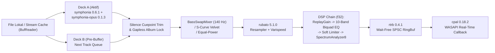

# Spesifikasi Teknis Implementasi: Audio, Radio, Win32 Acrylic & Sync (`SYNC_AND_AUDIO_SPEC.md`)

- **Versi Dokumen:** 2.0.0 (Sesuai Implementasi Aktual Workspace Rust `v0.1.0`)
- **Tanggal Pembaruan:** 25 November 2026

Dokumen ini mendokumentasikan kontrak teknis aktual yang berjalan di `ferric-audio`, `ferric-providers`, `ferric-sync`, `apps/ferric-desktop`, dan `vendor/makepad-platform`.

---

## 1. Engine Audio Native Rust (`crates/ferric-audio`)

Implementasi berada di [engine.rs](file:///d:/code/project/music%20player/ferric/crates/ferric-audio/src/engine.rs), [dsp.rs](file:///d:/code/project/music%20player/ferric/crates/ferric-audio/src/dsp.rs), dan [demo_synth.rs](file:///d:/code/project/music%20player/ferric/crates/ferric-audio/src/demo_synth.rs).

### 1.1 Pipeline Thread Bebas Lock

### 1.2 Algoritma Transisi & DSP (`dsp.rs`)
- **Equal-Power Crossfade:** $\theta = \frac{\pi}{2} \cdot t$, $g_A = \cos(\theta)$, $g_B = \sin(\theta)$ menjaga $g_A^2 + g_B^2 = 1$.
- **S-Curve Velvet:** $s = 3t^2 - 2t^3$ (Hermite cubic), $g_A = \sqrt{1 - s}$, $g_B = \sqrt{s}$.
- **Bass-Swap Automix (`140 Hz` Complementary Crossover):** Memisahkan frekuensi `< 140 Hz` (filter 1-pole $\alpha = 1 - e^{-2\pi \cdot 140 / f_s}$) dan `>= 140 Hz` (`hp = x - lp`). Sub-bass bertukar dengan kurva amplitudo konstan $(1 - s, s)$ untuk mencegah penumpukan bass +6 dB, sedangkan mid/high berpindah dengan gain equal-power, tetap *bit-transparent* pada $t = 0$ dan $t = 1$.
- **Micro-Fade & Gapless:** Envelope Hermite halus pada Play/Pause/Seek, serta **Gapless Album Lock** (`0 ms` crossfade khusus dua lagu lokal berurutan dalam album yang sama).
- **10-Band Parametric EQ & Spectrum:** 10 filter `biquad 0.6.0` (`DirectForm1`, `Peaking`/`LowShelf`/`HighShelf`) + preamp + soft-clip limiter + `SpectrumAnalyzer8` (dyadic filterbank 8-band `90 Hz .. 6 kHz` zero-lock ke atomik telemetri UI).

---

## 2. Smart Radio Queue, Discovery & Lyrics (`crates/ferric-providers`)

### 2.1 Multi-Artist Smart Radio Queue (`ytmusic.rs`)
Dipanggil melalui `fetch_radio_up_next_for_track(...)`:
1. **Deteksi Locale & Request Primer:** Mendeteksi bahasa/vibe lagu aktif (`GlobalEn`, `Indonesian`, `Japanese`, `Korean`) dan memanggil `youtubei/v1/next` pada `RDAMVM{video_id}`. Saat `force_fresh == true` (tombol Refresh Queue), parameter tuner dirotasi secara deterministik (`RADIO_FRESH_TICK`) melintasi preset *Discover*, *Deep Cuts*, *Popular*, dan *Upbeat/Chill*.
2. **Ekspansi Second-Hop:** Memilih video dari artis berbeda pada panel primer dan memanggil `RDAMVM{hop_vid}` kedua agar kolam kandidat kaya lintas artis.
3. **Filter Kualitas & Keragaman Ketat (`filter_coherent_radio_tracks`):**
   - Menolak durasi ekstrem (`< 75 dtk` atau `> 540 dtk`), variasi judul lagu yang sama (`normalize_core_title` / `is_same_song_variant`), serta spam cover/karaoke/pitch-shift/SEO (`+1key..+5key`, `-1key..-4key`, `key no`, `mini pop`, `kidz bop`, `metal version`, `cover`, `instrumental`, `lullaby`, `minecraft`, `extended`, `sped up`, `slowed`, `nightcore`, `remix` kecuali seed remix, `todays top hits`, `radio top hits`, `chill hit songs`, dll.).
   - **Batas Maksimal 1 Lagu per Artis:** Setiap `primary_artist_key` hanya boleh muncul 1 kali; artis lagu yang sedang diputar dibatasi maksimal 1 kali dan disisipkan di tengah antrean (tidak pernah posisi #1).
   - **Fallback Multi-Artis Berbasis Locale:** Jika kandidat kurang dari batas minimum, melakukan pencarian frasa hits multi-artis sesuai locale (tidak pernah mencari nama `seed_artist` mentah).

### 2.2 Waterfall Lirik 4 Tahap (`lyrics.rs`)
1. File `.lrc` lokal berdampingan dengan file audio.
2. Tag lirik tertanam (`lofty`).
3. `LRCLIB` (exact match -> fuzzy search dengan pembersihan judul `yt_cleaner.rs`).
4. `Lyrics.ovh` dengan auto-pacing berbasis durasi lagu.
Seluruh hasil disimpan ke tabel SQLite `lyrics_cache`.

### 2.3 Integrasi Katalog, Updater & Kebersihan Pustaka
- **Local Scanner (`local_scanner.rs`):** Walkdir + Lofty + normalisasi metadata.
- **Public Import & Subsonic (`public_sync.rs`, `subsonic.rs`):** Import URL playlist publik, `.m3u`/`.m3u8`/`.csv`, dan sinkronisasi OpenSubsonic/Navidrome.
- **AutoEq (`autoeq.rs`):** 24 profil headphone/IEM bawaan + pencarian instan.
- **Verified Updater (`updater.rs`):** Cek `https://api.github.com/repos/Raflyf/Ferric/releases/latest`, unduh `SHA256SUMS.txt` + `.msi`, validasi hash SHA-256 penuh sebelum meluncurkan `msiexec`/ShellExecuteW.
- **Kebersihan Tabel `Songs`:** Hasil browse Home, Load More, Detail, Search, dan Radio disimpan di memori dan **tidak** di-`upsert` ke SQLite `tracks`; hanya lagu lokal, lagu yang diputar, lagu yang di-like, dan isi playlist yang dipersistenkan. Migrasi satu kali `migration_pruned_ephemeral_v2` membersihkan bloat lama termasuk cache `stream_cache`.

---

## 3. Win32 DirectComposition Acrylic, Chrome & Optimasi RAM

### 3.1 Per-Pixel Native Windows 11 Acrylic (`vendor/makepad-platform` + `apps/ferric-desktop/src/shell.rs`)
- **Vendored Patch (`vendor/makepad-platform/src/os/windows/d3d11.rs` & `win32_window.rs`):**
  - Jendela memakai `WS_EX_NOREDIRECTIONBITMAP` dan swapchain DXGI DirectComposition (`CreateSwapChainForComposition` dengan `DXGI_ALPHA_MODE_PREMULTIPLIED` yang ditempel ke `IDCompositionTarget`/`IDCompositionVisual`).
  - Pass utama Makepad clear ke `#00000000`, sementara shader latar belakang (`body`, `top_bar`, `left_sidebar`, `right_sidebar`, `bottom_bar`) mengeluarkan warna premultiplied-alpha saat `acrylic_on > 0.5`.
  - `shell.rs` mengaktifkan `DWMWA_SYSTEMBACKDROP_TYPE = DWMSBT_TRANSIENTWINDOW` (`3`) + `DwmExtendFrameIntoClientArea(-1)` + `DWMWA_USE_IMMERSIVE_DARK_MODE`.
- **Anti-Ghost Caption & Maximize Presisi:**
  - `shell.rs` memastikan style jendela adalah `WS_POPUP | WS_THICKFRAME | WS_MINIMIZEBOX | WS_MAXIMIZEBOX | WS_SYSMENU` dengan `WS_CAPTION` dihapus eksplisit.
  - `WM_NCCALCSIZE` menjepit `rgrc[0] = mi.rcWork` saat maximize dan mengembalikan `LRESULT(0)` di semua state (`win32_window.rs` juga tidak lagi jatuh ke `DefWindowProcW` saat maximize, serta mengirim `self.get_inner_size()`).
  - `WM_NCHITTEST` mengubah `HTMINBUTTON` / `HTMAXBUTTON` / `HTCLOSE` / `HTSYSMENU` menjadi `HTCLIENT`.
- **Single-Instance Guard:** `CreateMutexW(Local\FerricMusicPlayerSingleInstance_v1)` + `RegisterWindowMessageW("FerricActivateExistingInstance_v1")` memulihkan jendela aktif/tray jika binary dijalankan dua kali.

### 3.2 Disiplin Memori & Anti-Flicker
- **Artwork LRU Cache (`artwork.rs`):** `MAX_CACHED_TEXTURES = 128` dengan pinning lagu aktif untuk mencegah LRU thrashing/kedip kartu selama pemutaran.
- **Setter Idempoten (`widgets.rs` & `app.rs`):** `FerricCoverArt::set_texture`, `FerricAmbientStage::set_state`, `FerricBarSlider::set_value`, `FerricWinBtn::set_maximized`, dan update label waktu pada `handle_tick` hanya memicu `redraw` bila nilai benar-benar berubah.
- **Background & Post-Stream Trim:** Saat jendela disembunyikan/diminimalkan atau setelah `StreamReady`, `db.shrink_memory()` dan `win32_trim_working_set()` (`SetProcessWorkingSetSizeEx` + `K32EmptyWorkingSet`) memangkas working set ke kisaran `7–8 MB` (idle/tray) dan `~44 MB` (streaming aktif).

---

## 4. Fondasi Ferric Connect (`crates/ferric-sync`)

### 4.1 Sudah Diimplementasikan di `v0.1.0`
- **Framing Biner (`lib.rs`):** `encode_frame` / `decode_frame` dengan header panjang `u32` little-endian (maks 1 MiB) + payload `postcard 1.2` untuk `SyncFrame` (`Ping`, `Pong`, `StateSnapshot`, `PlaybackDelta`, `Command`, `QueueFull`, `QueueMutation`).
- **Active Speaker Lease (`ActiveSpeakerLease`):** Penjaga konsistensi agar hanya satu perangkat mengeluarkan suara kecuali mode simulcast aktif.
- **LAN Discovery (`lan.rs`):** Beacon UDP non-blocking pada port `43821` (`FERRIC_LAN_UDP_PORT`) + deteksi IP LAN lokal (`detect_local_lan_ip`).
- **QR Code Pairing (`qr.rs`):** Encoder matriks ISO/IEC 18004 pure-Rust (`QrMatrix`) yang dirender langsung di tab `Settings > Connect` sebagai URI `ferric://pair?...`.

### 4.2 Belum Diimplementasikan (Pasca-`v0.1.0`)
- Transport lintas internet P2P QUIC penuh, transfer blob audio PC -> HP, dan klien pendamping Android (`apps/ferric-mobile` + `MediaSessionService` JNI + `oboe`).
