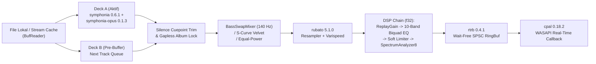

# Spesifikasi Teknis Implementasi: Audio, Radio, Win32 Acrylic, Keamanan & Sync (`SYNC_AND_AUDIO_SPEC.md`)

- **Versi Dokumen:** 2.2.0 (Sesuai Implementasi Aktual Workspace Rust `v0.1.0`)
- **Tanggal Pembaruan:** 26 November 2026

Dokumen ini mendokumentasikan kontrak teknis aktual yang berjalan di `ferric-core`, `ferric-audio`, `ferric-providers`, `ferric-sync`, `apps/ferric-desktop`, dan `vendor/makepad-platform`.

---

## 1. Engine Audio Native Rust (`crates/ferric-audio`)

Implementasi berada di `crates/ferric-audio/src/engine.rs`, `crates/ferric-audio/src/dsp.rs`, dan `crates/ferric-audio/src/demo_synth.rs`.

### 1.1 Pipeline Thread Bebas Lock

### 1.2 Algoritma Transisi & DSP (`dsp.rs` + `engine.rs`)
- **Auto-Only Crossfade Handoff:** Transisi crossfade `0–12 dtk` dipicu secara otomatis pada akhir alami lagu (menggunakan `Deck B` pre-buffered), sedangkan aksi skip manual (`Next`/`Prev`) langsung melakukan *hard handoff* instan dengan micro-fade Hermite agar status UI dan audio selalu sinkron tanpa lag transisi.
- **Equal-Power Crossfade:** $\theta = \frac{\pi}{2} \cdot t$, $g_A = \cos(\theta)$, $g_B = \sin(\theta)$ menjaga $g_A^2 + g_B^2 = 1$.
- **S-Curve Velvet:** $s = 3t^2 - 2t^3$ (Hermite cubic), $g_A = \sqrt{1 - s}$, $g_B = \sqrt{s}$.
- **Bass-Swap Automix (`140 Hz` Complementary Crossover):** Memisahkan frekuensi `< 140 Hz` (filter 1-pole $\alpha = 1 - e^{-2\pi \cdot 140 / f_s}$) dan `>= 140 Hz` (`hp = x - lp`). Sub-bass bertukar dengan kurva amplitudo konstan $(1 - s, s)$ untuk mencegah penumpukan bass +6 dB, sedangkan mid/high berpindah dengan gain equal-power, tetap *bit-transparent* pada $t = 0$ dan $t = 1$.
- **Micro-Fade & Gapless:** Envelope Hermite halus pada Play/Pause/Seek, serta **Gapless Album Lock** (`0 ms` crossfade khusus dua lagu lokal berurutan dalam album yang sama).
- **10-Band Parametric EQ & Spectrum:** 10 filter `biquad 0.6.0` (`DirectForm1`, `Peaking`/`LowShelf`/`HighShelf`) + preamp + soft-clip limiter + `SpectrumAnalyzer8` (dyadic filterbank 8-band `90 Hz .. 6 kHz` zero-lock ke atomik telemetri UI).

---

## 2. Smart Radio Queue, Discovery, Lyrics & OAuth (`crates/ferric-providers`)

### 2.1 Multi-Artist Smart Radio Queue, Personalized Home & Video Resolver (`ytmusic.rs`)
Dipanggil melalui `fetch_radio_up_next_for_track(...)`:
1. **Deteksi Locale & Request Primer:** Mendeteksi bahasa/vibe lagu aktif (`GlobalEn`, `Indonesian`, `Japanese`, `Korean`) dan memanggil `youtubei/v1/next` pada `RDAMVM{video_id}`. Saat `force_fresh == true` (tombol Refresh Queue), parameter tuner dirotasi secara deterministik (`RADIO_FRESH_TICK`) melintasi preset *Discover*, *Deep Cuts*, *Popular*, dan *Upbeat/Chill*.
2. **Ekspansi Second-Hop:** Memilih video dari artis berbeda pada panel primer dan memanggil `RDAMVM{hop_vid}` kedua agar kolam kandidat kaya lintas artis.
3. **Filter Kualitas & Keragaman Ketat (`filter_coherent_radio_tracks`):**
   - Menolak durasi ekstrem (`< 75 dtk` atau `> 540 dtk`), variasi judul lagu yang sama (`normalize_core_title` / `is_same_song_variant`), serta spam cover/karaoke/pitch-shift/SEO (`+1key..+5key`, `-1key..-4key`, `key no`, `mini pop`, `kidz bop`, `metal version`, `cover`, `instrumental`, `lullaby`, `minecraft`, `extended`, `sped up`, `slowed`, `nightcore`, `remix` kecuali seed remix, kanal SEO hits).
   - **Batas Maksimal 1 Lagu per Artis:** Setiap `primary_artist_key` hanya boleh muncul 1 kali; artis lagu yang sedang diputar dibatasi maksimal 1 kali dan disisipkan di tengah antrean (tidak pernah posisi #1).
   - **Fallback Multi-Artis Berbasis Locale:** Jika kandidat kurang dari batas minimum, melakukan pencarian frasa hits multi-artis sesuai locale (tidak pernah mencari nama `seed_artist` mentah).
4. **Taste-Driven Home & Official Video Resolver:** Halaman Home menyisipkan rekomendasi personal berdasarkan riwayat/taste lokal pengguna; mode Video di Fullscreen memprioritaskan resolusi video musik resmi yang sesuai lagu aktif dengan validasi URL stream ketat (`is_allowed_stream_url`).

### 2.2 Waterfall Lirik 4 Tahap, Filter Polusi & Cache Auto-Heal (`lyrics.rs`)
1. File `.lrc` lokal berdampingan dengan file audio (batas ukuran aman `2 MiB`).
2. Tag lirik tertanam (`lofty`).
3. `LRCLIB` (`/api/get` exact match -> `/api/search` fuzzy scoring dengan pembersihan judul `yt_cleaner.rs`, `max_redirects(0)`, timeout ketat, dan batas byte respons).
4. `Lyrics.ovh` dengan auto-pacing berbasis durasi lagu.

**Seleksi Lirik Asli Bersih (`lyrics_content_penalty` & `is_polluted_multilingual_lrc`):**
- Unggahan komunitas yang mencampurkan aksara Jepang Kana + Korea Hangul (`+4_500`), kolom terjemahan ganda `" / "` (`+4_000` / `+3_000`), atau mojibake `?` / `U+FFFD` (`+3_500`) dikenai penalti skor, sementara lagu dwibahasa resmi (mis. Inggris + Jepang atau Inggris + Korea) menerima penalti `0`.
- Jika `/api/get` mengembalikan unggahan tercemar (`penalty >= 2_500`), resolver otomatis jatuh ke `/api/search` untuk memilih lirik asli yang bersih.
- Pada saat memuat lirik dari `lyrics_cache` SQLite (`load_lyrics_for_track` di `app.rs`), entri cache lama yang terdeteksi tercemar otomatis dibuang dan diambil ulang (*auto-heal*).

### 2.3 Integrasi Katalog, OAuth PKCE, Updater & Kebersihan Pustaka
- **Local Scanner (`local_scanner.rs`):** Walkdir + Lofty + normalisasi metadata.
- **Public Import & Subsonic (`public_sync.rs`, `subsonic.rs`):** Import URL playlist/album/track publik (bekerja tanpa login), `.m3u`/`.m3u8`/`.csv`, dan sinkronisasi OpenSubsonic/Navidrome (auth token MD5 RFC 1321 terverifikasi unit test).
- **Official OAuth 2.0 PKCE (`oauth.rs`):** Mendukung sinkronisasi metadata baca-saja resmi Spotify (`user-read-private playlist-read-private playlist-read-collaborative user-library-read`) dan Google YouTube (`youtube.readonly`) menggunakan verifikator PKCE `S256` dari OS CSPRNG (`ferric_core::secrets::csprng_fill`) dan loopback listener `127.0.0.1:43824/callback` dengan verifikasi CSRF `state`. Tidak melakukan ekstraksi stream DRM tidak resmi.
- **AutoEq (`autoeq.rs`):** 24 profil headphone/IEM bawaan + pencarian instan.
- **Verified Updater (`updater.rs` + `shell.rs`):** Cek `https://api.github.com/repos/Raflyf/Ferric/releases/latest`, unduh `SHA256SUMS.txt` + `.msi` hanya dari host GitHub resmi, lalu `launch_verified_installer` memverifikasi tipe berkas reguler, containment kanonis di folder updates, menolak jalur UNC/perangkat, dan **menghitung ulang SHA-256 tepat sebelum mengeksekusi `%SystemRoot%\System32\msiexec.exe` via `CreateProcessW`** (tahan TOCTOU).
- **Kebersihan Tabel `Songs`:** Hasil browse Home, Load More, Detail, Search, dan Radio disimpan di memori dan **tidak** di-`upsert` ke SQLite `tracks`; hanya lagu lokal, lagu yang diputar, lagu yang di-like, dan isi playlist yang dipersistenkan (`migration_pruned_ephemeral_v2` membersihkan bloat lama).

---

## 3. Win32 DirectComposition Acrylic, OS Fonts, IPC & Keamanan

### 3.1 Kebijakan GPU Hemat-RAM DX11, Cold-Start Acrylic, SMTC & Menu Tray (`vendor/makepad-platform` + `shell.rs` + `smtc.rs`)
- **Seleksi Adapter DXGI Hemat-RAM (`d3d11.rs::D3d11Cx::new`):**
  1. **Tanpa opsi/pemaksaan Dedicated GPU:** Memeriksa `EnumAdapters1(0)` terlebih dahulu; bila sudah berupa Integrated GPU (`DedicatedVideoMemory < 1 GiB` non-software), langsung dipakai tanpa mengenumerasi adapter diskret sekunder sehingga driver dGPU tidak pernah termuat ke RAM.
  2. Pada sistem hybrid dengan dGPU di slot `0`, mencari dan memprioritaskan Integrated GPU hemat-RAM terlebih dahulu; hanya menggunakan GPU utama bila sistem tidak memiliki iGPU sama sekali, lalu fallback otomatis ke **CPU WARP (`D3D_DRIVER_TYPE_WARP`)**.
  3. `CxOsPass::set_states` mengikat `ID3D11SamplerState` eksplisit (`D3D11_FILTER_MIN_MAG_MIP_LINEAR`, `MaxLOD = f32::MAX`) pada slot `s0`; `update_vec_texture` mengunggah sampul sebagai `D3D11_USAGE_IMMUTABLE` lalu melepas `Vec<u32>` CPU; dan `CxOsDrawShader::new` langsung melepas `ID3DBlob` bytecode setelah shader dibuat.
- **Urutan Inisialisasi Cold-Start & Pemulihan Acrylic:**
  1. `Event::Startup` di `app.rs` mengisi `INITIAL_ACRYLIC_BACKDROP` dari `ThemeConfig` SQLite sebelum jendela utama dibuat.
  2. Di `vendor/makepad-platform/src/os/windows/win32_window.rs` (`Win32Window::init`), `DWMWA_USE_IMMERSIVE_DARK_MODE`, `DWMWCP_ROUND`, `DwmExtendFrameIntoClientArea(-1)`, dan `DWMWA_SYSTEMBACKDROP_TYPE = DWMSBT_TRANSIENTWINDOW` (`3`) diterapkan **sebelum `CreateTargetForHwnd` dan `ShowWindow(SW_SHOW)`**.
  3. `d3d11.rs` menggunakan `WS_EX_NOREDIRECTIONBITMAP` + `CreateSwapChainForComposition` (`DXGI_ALPHA_MODE_PREMULTIPLIED`) dan memanggil `dcomp_dev.Commit()` sebelum jendela ditampilkan.
  4. `WM_NCACTIVATE` meneruskan `wparam` asli dengan `LPARAM(-1)` (tanpa memalsukan aktivasi agar state machine DWM tidak macet di solid fallback) dan menegaskan ulang backdrop saat aktif (`WM_NCACTIVATE`/`WM_ACTIVATE`), restore (`WM_SIZE`), dan perubahan tema/komposisi (`WM_THEMECHANGED`/`WM_DWMCOMPOSITIONCHANGED`).
- **Windows SMTC Penuh (`smtc.rs`) & Identitas AUMID (`shell.rs` + `Ferric.wxs`):**
  - Mendaftarkan `HKCU\Software\Classes\AppUserModelId\Raflyf.Ferric` (`DisplayName = "Ferric"`, `IconUri`) agar Windows 11 Quick Settings dan aplikasi overlay pihak ketiga Microsoft Store (Nusa Pro, NotchPixel, ModernFlyouts, Seelen UI) mengenali aplikasi Ferric.
  - Menerbitkan thumbnail sampul lokal `file://` dari `artwork_cache/smtc_now_playing.{jpg|png}` (dengan fallback HTTPS) dan memperbarui `TimelineProperties` (`Position`, `StartTime`, `EndTime`, `MaxSeekTime`) secara real-time (1 Hz saat bermain, instan saat pause/seek/durasi terbaca — tidak pernah mereset posisi ke `00:00`), serta mendukung event `SetPosition` / `Seek` dari overlay eksternal.
- **Menu Klik Kanan System Tray Mengikuti Tema Perangkat:** `sync_win32_popup_menu_theme()` membaca `HKCU\...\Themes\Personalize\SystemUsesLightTheme` dan memanggil `uxtheme.dll` ordinal `#135` (`SetPreferredAppMode`) + `#136` (`FlushMenuThemes`) saat inisialisasi, `WM_SETTINGCHANGE`, dan sebelum `TrackPopupMenu`.
- **Anti-Ghost Caption & Maximize Presisi:**
  - `shell.rs` memastikan style jendela `WS_POPUP | WS_THICKFRAME | WS_MINIMIZEBOX | WS_MAXIMIZEBOX | WS_SYSMENU` (**tanpa `WS_CAPTION`**).
  - `WM_NCCALCSIZE` menjepit `rgrc[0] = mi.rcWork` saat maximize dan mengembalikan `LRESULT(0)` di semua state (`win32_window.rs` mengirim `self.get_inner_size()`).
  - `WM_NCHITTEST` mengubah `HTMINBUTTON` / `HTMAXBUTTON` / `HTCLOSE` / `HTSYSMENU` menjadi `HTCLIENT`.
- **Single-Instance, Taskbar ThumbBar & Discord RPC:**
  - Single-instance mutex `Local\FerricMusicPlayerSingleInstance_v1` + `RegisterWindowMessageW("FerricActivateExistingInstance_v1")`.
  - `ITaskbarList3::ThumbBarAddButtons` di `shell.rs` menyediakan tombol pratinjau Taskbar (`Prev`, `Play/Pause`, `Next`) tersinkron dengan status putar.
  - `discord_rpc.rs` berkomunikasi langsung dengan Discord Desktop via Windows named pipe (`\\.\pipe\discord-ipc-0..9`) pada satu thread latar tidur menggunakan Activity Type `2` (`Listening`), App ID bawaan `1575176866413940806`, ikon kaset `small_image`, deduplikasi tick `3 dtk`, dan menyembunyikan `large_text` saat album sama dengan judul lagu.

### 3.2 Disiplin Memori, Virtual OS Fonts & Anti-Flicker
- **Zero-Bloat OS Fallback Fonts (`vendor/makepad-platform/src/os/cx_native.rs`):** Slot virtual `__sys_cjk_jp.ttf`, `__sys_cjk_kr.ttf`, `__sys_cjk_cn.ttf`, dan `__sys_thai.ttf` dimuat pada pass kedua dari `%SystemRoot%\Fonts` dengan validasi header SFNT/TTC (`<= 32 MiB`) dan dibagikan sekali via `Rc<Vec<u8>>` / `Rc`, jatuh aman ke `Inter-Regular.ttf` jika font tidak ada.
- **Artwork LRU Cache (`artwork.rs`):** `MAX_CACHED_TEXTURES = 144`, downscaler *area-box* (`160px` kartu / `256px` hero) dengan pinning lagu aktif, `CxTexturePool::free_unused_textures()`, tekstur GPU `D3D11_USAGE_IMMUTABLE`, dan pembebasan `Vec<u32>` CPU segera setelah upload.
- **Setter Idempoten (`widgets.rs` & `app.rs`):** `FerricCoverArt::set_texture`, `FerricAmbientStage::set_state`, `FerricBarSlider::set_value` (deadband `2.5e-3`), `FerricWinBtn::set_maximized`, serta label waktu pada `handle_tick` hanya memicu `redraw` bila nilai berubah.
- **Clean Uninstall MSI (`installer/Ferric.wxs`):** `CleanUninstallUserData` (`WixQuietExec64`, dijalankan hanya pada `REMOVE="ALL" AND NOT UPGRADINGPRODUCTCODE`) membersihkan `%LOCALAPPDATA%\LivelyDesk\Ferric` (SQLite DB + WAL/SHM, `artwork_cache`, `stream_cache`, profil WebView2, `updates`, `demo_tracks`), menghapus `%LOCALAPPDATA%\LivelyDesk` bila kosong, membersihkan `%LOCALAPPDATA%\Programs\Ferric`, `%TEMP%\ferric_spotify_capture.txt`, serta kunci registry `HKCU\Software\Raflyf\Ferric` dan `HKCU\Software\Classes\AppUserModelId\Raflyf.Ferric`.

### 3.3 Keamanan Runtime, Sandbox WebView2 & Pengerasan PE
- **Enkripsi Rahasia at Rest (`crates/ferric-core/src/secrets.rs`):** Menggunakan `CryptProtectData`/`CryptUnprotectData` (`crypt32.dll`, prefix `dpapi:v1:`, entropy `Ferric.Accounts.DPAPI.v1`) dan `BCryptGenRandom` (`bcrypt.dll`) tanpa dependensi crate eksternal.
- **Mitigasi Proses Win32 (`shell.rs::harden_process`):** Dipanggil paling awal di `main.rs` untuk `SetDllDirectoryW("")`, `SetDefaultDllDirectories(LOAD_LIBRARY_SEARCH_SYSTEM32)`, `HeapSetInformation(HEAP_ENABLE_TERMINATION_ON_CORRUPTION)`, dan `SetProcessMitigationPolicy` (`ProcessImageLoadPolicy` NoRemote/NoLowLabel/PreferSystem32 + `ProcessExtensionPointDisablePolicy`), plus `SetCurrentProcessExplicitAppUserModelID("Raflyf.Ferric")`.
- **Sandbox WebView2 (`video_player.rs`, `google_login.rs`):**
  - CSP ketat + `no-referrer`; menonaktifkan DevTools, context menu default, host objects, web messages, accelerator keys, autofill, dan swipe navigation; menolak seluruh `PermissionRequested`; memblokir `NewWindowRequested`; validasi ketat URL pada `NavigationStarting`; `js_quote_safe` untuk setiap payload JS; validasi ketat URI lokal `file:///` (hanya `mp4`/`webm`/`mkv`, blokir `..` dan UNC).
  - Kliping sudut membulat tunggal `CreateRoundRectRgn` (`16px` terskala DPI) tanpa sudut DWM ganda atau stroke luar bertumpuk.
- **Allowlist URL Eksternal (`shell.rs::open_allowed_url`):** Fail-closed hanya ke HTTPS `github.com/Raflyf/Ferric`, `accounts.spotify.com`, `developer.spotify.com`, `accounts.google.com`, `console.cloud.google.com`, dan `discord.com/developers/applications`.
- **Hardened Reproducible PE (`Cargo.toml`, `.github/workflows/*.yml`, `scripts/verify_pe_hardening.py`):**
  - Profile rilis: `opt-level = 3`, `lto = "fat"`, `codegen-units = 1`, `debug = false`, `strip = "symbols"`, `panic = "abort"`.
  - Flag MSVC/rustc CI: `-C control-flow-guard=yes`, `/GUARD:CF`, `/CETCOMPAT`, `/DYNAMICBASE`, `/HIGHENTROPYVA`, `/NXCOMPAT`, `/DEBUG:NONE`, `/NOCOFFGRPINFO`, `/INCREMENTAL:NO`, `/OPT:REF`, `/OPT:ICF`, `/BREPRO`, `CARGO_HOME=C:\c`, `subst S:`, `--remap-path-prefix`, dan `/d1trimfile`.
  - `verify_pe_hardening.py` memverifikasi seluruh bit `DllCharacteristics`, Debug Directory (`BREPRO` & `CETCOMPAT` ada, CodeView RSDS & POGO/COFFGRP tidak ada), serta nol kebocoran string ASCII/UTF-16 (`.pdb`, `runneradmin`, `d:\a\`, `c:\users\`).

---

## 4. Fondasi Ferric Connect (`crates/ferric-sync`)

### 4.1 Sudah Diimplementasikan di `v0.1.0`
- **Framing Biner (`lib.rs`):** `encode_frame` / `decode_frame` dengan header panjang `u32` little-endian (maks 1 MiB) + payload `postcard 1.2` + validasi skema `validate_frame` untuk `SyncFrame` (`Ping`, `Pong`, `StateSnapshot`, `PlaybackDelta`, `Command`, `QueueFull`, `QueueMutation`).
- **Active Speaker Lease (`ActiveSpeakerLease`):** Penjaga konsistensi agar hanya satu perangkat mengeluarkan suara kecuali mode simulcast aktif.
- **LAN Discovery (`lan.rs`):** Beacon UDP non-blocking pada port `43821` (`FERRIC_LAN_UDP_PORT`) + deteksi IP LAN lokal (`detect_local_lan_ip`).
- **QR Code Pairing (`qr.rs`):** Encoder matriks ISO/IEC 18004 pure-Rust (`QrMatrix`) yang dirender langsung di tab `Settings > Connect` sebagai URI `ferric://pair?...`.

### 4.2 Belum Diimplementasikan (Pasca-`v0.1.0`)
- Transport lintas internet P2P QUIC penuh, transfer blob audio PC -> HP, dan klien pendamping Android (`apps/ferric-mobile` + `MediaSessionService` JNI + `oboe`).
