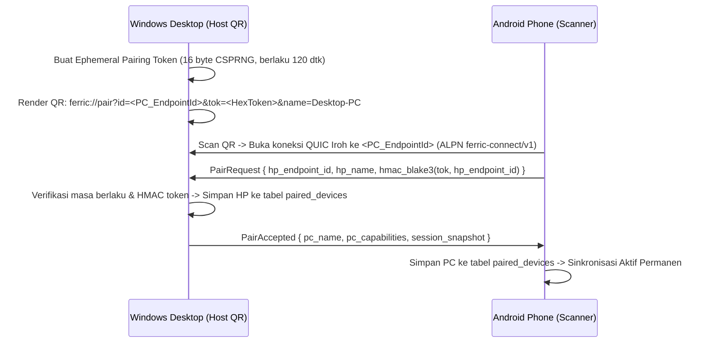
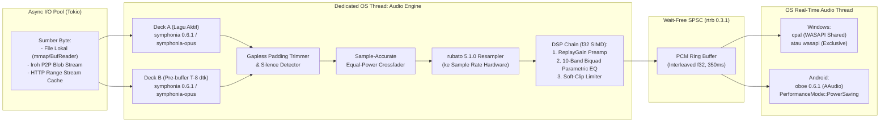

# Spesifikasi Teknis Mendalam: Protokol Sinkronisasi PC <-> HP & Engine Audio Rust

Dokumen ini adalah lampiran teknis tingkat implementasi (*low-level engineering specification*) dari [PRD.md](file:///d:/code/project/music%20player/PRD.md) agar AI agent atau engineer berikutnya dapat langsung menulis kode Rust tanpa menebak kontrak data maupun arsitektur thread.

---

## 1. Spesifikasi Protokol "Ferric Connect" (`ferric-sync`)

### 1.1 Transport & Penemuan Perangkat (*Dual-Path Zero-Server*)
- **Crate Utama:** `iroh = "1.4.1"`, `iroh-blobs`, `mdns-sd = "0.22.0"`, `postcard = "1.1"`, `ed25519-dalek`.
- **ALPN Identifier:** `b"ferric-connect/v1"`
- **Jalur Penemuan:**
  1. **Jaringan Lokal (Wi-Fi / Ethernet yang sama):** `mdns-sd` menyiarkan layanan `_ferric-connect._udp.local.` berisi TXT record `endpoint_id=<iroh_pubkey>` dan `name=<device_name>`. `iroh` langsung membuka koneksi QUIC lokal di IP LAN (< 5 ms RTT, 0 kuota internet). Catatan khusus Android: ambil `WifiManager.MulticastLock` via JNI hanya selama layar pemilih perangkat dibuka agar tidak boros baterai!
  2. **Lintas Jaringan (HP di 4G/5G Seluler <-> PC di Wi-Fi Rumah):** Menggunakan `EndpointId` (Ed25519 32-byte) yang sudah di-pair sebelumnya via QR Code. `iroh` otomatis melakukan *UDP hole-punching* (QAD) dan jatuh ke relay terenkripsi *end-to-end* TLS 1.3 jika berada di balik Symmetric CGNAT operator seluler.

### 1.2 Alur Pairing QR Code Sekali Pakai


### 1.3 Kontrak Pesan Biner (`postcard` di atas Bi-Directional QUIC Stream)
Setiap frame diawali header `u32` (little-endian panjang byte, maks 1 MiB) diikuti payload `postcard`:

```rust
use serde::{Deserialize, Serialize};

#[derive(Debug, Clone, Serialize, Deserialize)]
pub enum SyncFrame {
    // 1. Heartbeat & Kalibrasi Offset Jam (NTP-style untuk akurasi <15ms)
    Ping { client_send_mono_ms: u64, client_wall_utc_ms: i64 },
    Pong { client_send_mono_ms: u64, server_recv_utc_ms: i64, server_send_utc_ms: i64 },

    // 2. Snapshot & Delta Status Pemutaran
    StateSnapshot(SessionState),
    PlaybackDelta {
        revision: u64,
        active_speaker: Option<DeviceId>,
        is_playing: bool,
        track_id: Option<String>,
        // Posisi dihitung dinamis: pos_now = base_position_ms + (now_utc_ms - anchor_utc_ms) * speed
        base_position_ms: u64,
        anchor_utc_ms: i64,
        volume_norm: f32, // 0.0 ..= 1.0
        repeat_mode: RepeatMode,
        shuffle_enabled: bool,
    },

    // 3. Perintah Remote Control (HP mengontrol PC atau PC mengontrol HP)
    Command {
        cmd_id: u64,
        action: RemoteAction,
    },

    // 4. Sinkronisasi Antrean (Queue) Hemat Bandwidth
    QueueFull { revision: u64, tracks: Vec<QueueEntry>, current_index: usize },
    QueueMutation { revision: u64, op: QueueOp },
}

#[derive(Debug, Clone, Serialize, Deserialize)]
pub enum RemoteAction {
    Play,
    Pause,
    TogglePlayPause,
    SeekTo { position_ms: u64 },
    SkipNext,
    SkipPrev,
    JumpToQueueIndex { index: usize },
    SetVolume { target_device: DeviceId, volume_norm: f32 },
    SetRepeat(RepeatMode),
    SetShuffle(bool),
    // Memindahkan output suara aktif dari PC ke HP atau sebaliknya tanpa jeda!
    TransferActiveSpeaker { new_speaker: DeviceId, start_playing: bool },
    // Mode dengar bareng serentak di PC + HP
    SetSimulcastMode { enabled: bool, participants: Vec<DeviceId> },
}
```

### 1.4 Mesin Status *Active Speaker Lease* (Mencegah Suara Dobel Tidak Sengaja)
1. Secara default dalam grup perangkat pribadi pengguna, **hanya satu perangkat** yang memegang token `active_speaker = Some(device_id)`. Perangkat tersebut mengeluarkan suara ke hardware audio (`cpal`/`oboe`), sementara perangkat lain masuk ke **Remote Controller Mode** (UI menampilkan lagu, lirik, dan seekbar milik `active_speaker`, dengan penggunaan CPU audio = 0%).
2. Ketika pengguna menekan **"Putar di Perangkat Ini"** pada HP:
   - HP mulai melakukan *pre-buffer* `track_id` pada `position_ms` saat ini + estimasi RTT/2.
   - Begitu buffer siap (<150 ms), HP mengirim `RemoteAction::TransferActiveSpeaker { new_speaker: hp_id, start_playing: true }`.
   - PC menerima pesan tersebut, menaikkan `revision`, menghentikan stream hardware audio PC secara *fade-out* halus 30 ms, dan menyerahkan status `active_speaker` ke HP.
3. Jika file lagu yang sedang diputar di PC adalah **file lokal yang hanya ada di hardisk PC** (`local:...`), maka saat pengguna memindahkan output suara ke HP, HP otomatis me-stream byte audio tersebut langsung dari PC menggunakan **`iroh-blobs` Verified Range Stream** sehingga lagu lokal PC tetap lanjut berbunyi di HP!

---

## 2. Spesifikasi Engine Audio Native Rust (`ferric-audio`)

### 2.1 Arsitektur Thread Bebas Lock (*Zero-Allocation Real-Time Callback*)



### 2.2 Rumus Equal-Power Crossfade & Gapless
- **Gapless:** Baca `CodecParameters::delay` (jumlah sampel awal yang harus dibuang) dan `CodecParameters::padding` (jumlah sampel akhir yang harus dibuang) dari demuxer `symphonia`. Saat `Deck A` mencapai sampel valid terakhir dan crossfade bernilai `0 ms`, sampel pertama `Deck B` langsung disambung di dalam iterasi buffer yang sama sebelum dikirim ke `rubato` (jika kedua lagu memiliki *sample rate* sama) atau setelah `rubato` (jika *sample rate* berbeda), menghasilkan **0 sampel keheningan**.
- **Equal-Power Crossfade (Durasi $T$ sampel, indeks $n \in [0, T)$):**
  $$\theta = \frac{\pi}{2} \cdot \frac{n}{T}, \quad g_A(n) = \cos(\theta), \quad g_B(n) = \sin(\theta)$$
  $$y[n] = g_A(n) \cdot x_A[n] + g_B(n) \cdot x_B[n]$$
  Menjaga daya akustik konstan ($g_A^2 + g_B^2 = 1$) sehingga volume tidak terasa turun di tengah transisi lagu.

---

## 3. Kontrak Normalisasi Multi-Akun (Spotify + YT Music) & Trait Resolver Audio (`ferric-providers`)

Untuk menyatukan metadata dari **Spotify Web API** dan **YouTube Data API v3** (mencakup YouTube & YouTube Music) sekaligus memisahkannya dari sumber pemutaran audio secara bersih:

### 3.1 Pipeline Normalisasi Metadata YouTube & YouTube Music (`yt_metadata_cleaner`)
Karena YouTube dan YouTube Music menggunakan objek video yang sama (`youtube#video`), sebelum disimpan ke tabel `tracks` atau dikirim ke `AudioResolver`, modul `yt_metadata_cleaner` menjalankan aturan deterministik bebas alokasi berat:
1. **Deteksi Channel "Auto-Generated by YouTube Music":** Jika `channelTitle` berakhiran `" - Topic"`, potong suffix tersebut dan tetapkan sebagai `artist` utama dengan tingkat kepercayaan tinggi (`is_yt_music_topic = true`).
2. **Pemisahan Pola `"Artis - Judul"`:** Jika bukan channel `- Topic` dan judul mengandung pemisah `" - "` atau `" – "`, ekstrak bagian kiri sebagai kandidat artis dan bagian kanan sebagai judul lagu.
3. **Pembersihan Label Video (`aho-corasick`):** Hapus tag non-judul seperti `(Official Music Video)`, `(Official Video)`, `[Official Audio]`, `(Lyrics)`, `[Lyric Video]`, `(Visualizer)`, `[MV]`, `(HD)`, `(4K)` tanpa menghapus informasi remix/versi penting seperti `(Acoustic)` atau `(Live)`.
4. **Sinkronisasi Inkremental Hemat Kuota YouTube Data API v3:**
   - Gunakan `playlists.list?mine=true` dan `playlists.list?id=LL` (Liked Songs) dengan header HTTP `If-None-Match: "<cached_etag>"`. Jika respons `304 Not Modified`, hentikan sinkronisasi (0 unit pemborosan).
   - Hanya panggil `videos.list?part=snippet,contentDetails&id=<50_video_ids>` (1 unit per 50 lagu) untuk ID lagu baru yang belum ada di SQLite lokal, dan tandai `snippet.categoryId == "10"` sebagai entri musik murni.

### 3.2 Kontrak Trait `AudioResolver`

```rust
use async_trait::async_trait;

#[derive(Debug, Clone)]
pub struct TrackQuery {
    pub canonical_id: String,
    pub spotify_id: Option<String>,
    pub youtube_video_id: Option<String>,
    pub isrc: Option<String>,
    pub title: String,
    pub artists: Vec<String>,
    pub album: Option<String>,
    pub duration_ms: u64,
}

#[derive(Debug, Clone)]
pub struct ResolvedStream {
    pub provider_id: String,
    pub stream_locator: StreamLocator,
    pub codec_hint: Option<String>,
    pub bitrate_kbps: Option<u32>,
    pub confidence: f32, // 0.0 ..= 1.0 (minimal >= 0.82 untuk auto-play)
}

#[derive(Debug, Clone)]
pub enum StreamLocator {
    LocalPath(std::path::PathBuf),
    IrohBlob { peer: String, blake3_hash: [u8; 32], size_bytes: u64 },
    HttpRangeUrl { url: String, headers: Vec<(String, String)>, expires_at_utc: Option<i64> },
}

#[async_trait]
pub trait AudioResolver: Send + Sync {
    fn id(&self) -> &'static str;
    fn priority(&self) -> u8; // 0 = tertinggi (Local File -> Iroh Home PC -> Subsonic -> Open Catalog -> WASM Plugin)
    async fn resolve(&self, query: &TrackQuery) -> anyhow::Result<Option<ResolvedStream>>;
}
```

---

## 4. Kontrak Integrasi Lifecycle Hemat Baterai & RAM di Android + Windows

### 4.1 Android Thin Foreground Service (`MediaSessionService`)
Di Android 14/15/16, aplikasi Rust murni (`NativeActivity`) yang hanya memakai NDK **pasti dimatikan oleh OS** dalam <1 menit saat layar mati kecuali prosesnya memiliki `Service` Android berstatus *Foreground* dengan tipe `mediaPlayback`.
- **Solusi Minimalis (~150 baris Kotlin, 0 ketergantungan Compose/ExoPlayer):**
  - `FerricMediaService : Service()` mendeklarasikan `android:foregroundServiceType="mediaPlayback"` di `AndroidManifest.xml`.
  - Memegang `MediaSession` standar OS Android (bukan Media3 ExoPlayer yang berat!) untuk mengirim metadata lagu & sampul ke Lockscreen, Notifikasi, Jam Tangan Pintar (WearOS), dan tombol TWS Bluetooth AVRCP.
  - Seluruh aksi (`onPlay`, `onPause`, `onSkipToNext`, `onSeekTo`) diteruskan langsung ke fungsi C-ABI Rust:
    - `Java_app_ferric_FerricBridge_nativeOnMediaAction(env, clazz, action_code: jint, arg_ms: jlong)`
  - Ketika `MainActivity.onStop()` dipanggil (pengguna menekan tombol Home atau mematikan layar HP):
    - Rust UI (`Makepad`) menghancurkan seluruh *texture cache* sampul album dan menghentikan *swapchain* Vulkan/GLES (`0 MB` VRAM, `0%` GPU), sementara `FerricMediaService` menjaga singleton Rust (`ferric-audio` + `ferric-sync`) tetap berjalan ringan (~12–18 MB RAM).

### 4.2 Windows Minimize-to-Tray & Occlusion Saver
- Pantau event `WM_SIZE` (`SIZE_MINIMIZED`) dan penutupan jendela ke System Tray (`tray-icon 0.26.1`).
- Saat jendela tidak terlihat di layar:
  1. Hentikan seluruh subscription animasi UI (seekbar tick, lirik scroll, spectrum FFT).
  2. Panggil `atlas.trim_unused_textures()` pada renderer DirectX 11 dan panggil Win32 `SetProcessWorkingSetSizeEx` secara halus atau bebaskan buffer gambar sampul yang sudah didekode.
  3. Pertahankan kontrol penuh melalui tombol media keyboard, flyout Windows 11 (`souvlaki 0.9.3`), dan *Taskbar Thumbnail Buttons*.
