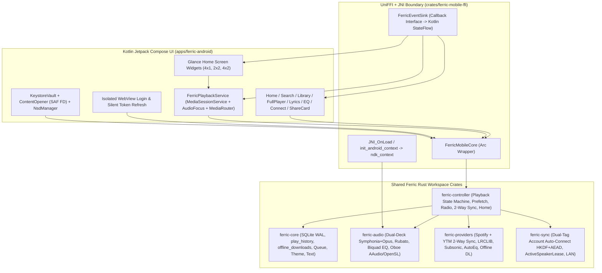

# Ferric Android Design Specification (`v0.1` + Phase 2 Roadmap)

- **Date:** 2026-11-27
- **Status:** Approved (2026-11-27; Builder Check audited against workspace crates)
- **Repository:** `d:\code\project\music player\ferric` (monorepo alongside Ferric Windows Desktop `v0.1.3`)
- **Primary Baseline:** Ferric Windows Desktop + touch-first optical Liquid Glass mobile architecture

---

## 1. Product Vision & UX Direction

**Ferric Android** brings 100% of Ferric Desktop's native Rust audio engine, unified local/streaming library, two-way Spotify & YouTube Music account sync, and low-resource discipline to Android, paired with an expressive, touch-first optical Liquid Glass mobile interface.

### Core UX Principle: Familiar Navigation, Expressive Visuals
- **Familiar navigation:** Fast bottom navigation (`Home`, `Search`, `Library`), instant 1-tap `Quick Picks`, swipeable Queue management, and zero-clutter search so users never hunt for basic actions.
- **Expressive customization:** Users choose their visual identity rather than being locked into one look:
  - **AMOLED Black (Default):** Pure `#000000` OLED canvas + Ferric Burnt Orange `#E86A2C` + Adaptive Artwork Accent (`WCAG AA >= 4.5:1`).
  - **Liquid Glass (iOS-inspired Android Glass):** Real-time frosted/refractive glass panels (`Haze` `hazeGlass`/`hazeBlur` + AGSL subtle refraction on Android 12+/13+ with graceful frosted tint fallback on Android 8-11) tinted dynamically from the playing cover (`CoverShade`).
  - **Obsidian Studio & Warm Cream Light:** Full parity with Ferric Desktop themes, importable/exportable via `.ferric-theme.json`, plus an optional **Editorial** typography layout mode and selectable UI font family.
- **Zero-friction cross-device continuity:** Signing in with the same Spotify or YouTube Music account on Ferric Desktop and Ferric Android automatically links both devices via **Ferric Connect** (no Bluetooth, no QR scan required on the same Wi-Fi/LAN) with live remote playback control, remote volume slider, and 1-tap audio output handoff.

---

## 2. Goals, Non-Goals & Phased Scope

### Phase 1 (`v0.1` Android: Incremental Milestones M1-M6)
**Goals (Must ship in `v0.1`, built incrementally so every milestone is runnable and testable):**
1. **100% Core Feature Parity with Ferric Desktop `v0.1.2`:**
   - **Home & Discovery:** Greeting header, Mood Chips, `Quick Picks`, `Recommended Stations` (dual engine: Spotify Pathfinder + multi-locale algorithmic stations), personalized shelves, weighted `Refresh`, `Play All` / `Shuffle`.
   - **Search:** Zero-allocation instant local search (`ferric_core::text`), debounced live YouTube Music search, search history chips, category filters (`All`, `Songs`, `Albums`, `Artists`, `Playlists`, `Local`), and direct Spotify/YouTube URL paste import.
   - **Library & Two-Way Cloud Sync:** `Songs`, `Albums`, `Artists`, `Playlists`, `Liked Songs`, `Recents`, `Local Lossless` (Android `MediaStore` + SAF custom folder picker via `ContentOpener` FD bridge for FLAC/MP3/AAC/M4A/ALAC/Opus/Ogg/WAV/AIFF), Spotify (Free & Premium) and YouTube Music login via app-private Android `WebView` with two-way playlist & like sync, `Sync to Account` for local playlists, `.m3u`/`.csv` import/export, playlist `Sort` & `Deduplicate`, OpenSubsonic/Navidrome catalog sync + stream playback, and Copy Song/Playlist links for Discord bots.
   - **Native Rust Dual-Deck Audio Engine (`ferric-audio` via `oboe`):** `Deck A + Deck B` pre-buffering, auto-only crossfade (`0-12s`, Bass-Swap Automix 140 Hz, S-Curve Velvet, Equal-Power), Gapless Album Lock, silence trim, ReplayGain, Playback Speed (`0.75x`-`1.5x`), Mono downmix, Sleep Timer, multiplicative Audio Focus ducking, 10-band Parametric Biquad EQ + live interactive frequency response curve + 13 presets + 24 AutoEq profiles + Equalizer APO `.txt` import/export, and Android System Output Switcher (`MediaRouter` / `MediaRouter2`) route selector (Phone Speaker / Wired Headset / Bluetooth / USB DAC).
   - **Player, Synced Lyrics & Video Clip:** Swipeable MiniPlayer (`Left/Right` skip, `Up` expand), Fullscreen Player with **Aurora Backdrop**, synced lyrics (`LRCLIB` + `Lyrics.ovh` + local `.lrc` via `ContentOpener` + embedded tags, `-0.5s`/`+0.5s` offset, tap line to seek), docked **Video Clip** toggle (ExoPlayer/Media3 video surface muted & clock-locked to Rust audio engine), Queue bottom sheet (drag reorder, Save Queue, Copy Queue), and clickable artist navigation.
   - **Android OS Foundation:** Foreground `MediaSessionService` (lazy Rust `AudioEngine` startup, media notification, lockscreen controls, Bluetooth/headset buttons, audio focus duck/pause, `ACTION_AUDIO_BECOMING_NOISY` pause on unplug), Android Keystore hardware-backed credential encryption, and zero-telemetry local SQLite WAL.
   - **Ferric Connect (Zero-Pairing Same-Account Auto-Connect on LAN + Desktop Parity):** Automatic discovery (`FRC2` UDP + mDNS/NSD) and ChaCha20-Poly1305 AEAD connection between Ferric Android and Ferric Windows Desktop signed in to the same Spotify or YouTube Music account (including mixed dual-account logins), Spotify-Connect-style bottom sheet / desktop side panel with active device badge, remote volume slider, full bidirectional playback/queue control, 1-tap speaker handoff (`This phone` <-> `Desktop PC`), plus QR Code pairing fallback for Guest Mode.
2. **High-Impact Optical & Mobile Experience Features (Included in `v0.1`):**
   - **Visual & Theme Studio:** `AMOLED Black`, `Liquid Glass`, `Obsidian Studio`, `Warm Cream Light`, `Editorial` toggle, `Adaptive Artwork Accent`, `CoverShade` glass tinting, UI font picker (`Inter`, `Plus Jakarta Sans`, `DM Sans`, `Space Grotesk`, `JetBrains Mono`), and player layout selector (`Standard`, `Full-Bleed`, `Liquid Glass`).
   - **Offline Downloads & Smart Audio Cache:** Download tracks/playlists to isolated persistent storage (`filesDir/ferric/offline_downloads/`) with storage cap controls and offline availability indicator.
   - **Lyrics Share Card / Mini Poster Generator:** Select 1-5 lyric lines or a playlist to generate and share styled `9:16 Story` or `1:1 Square` PNG cards (Liquid Glass / AMOLED / Adaptive Gradient).
   - **Home Screen Widgets (3 Core Sizes):** `Compact Strip (4x1)`, `Square Cover (2x2)`, and `Liquid Glass Card (4x2)` built with Jetpack Glance / RemoteViews.
   - **Listening Stats & Streak Summary** (backed by a new timestamped `play_history` SQLite table) + **Searchable Settings Hub** (live filter across all settings entries).
3. **Dual Release APK Packaging:**
   - Dedicated `arm64-v8a` APK (`ferric-vX.Y.Z-android-arm64-v8a.apk`, target ~18-22 MB) AND universal multi-ABI APK (`ferric-vX.Y.Z-android-universal.apk` bundling `arm64-v8a` + `armeabi-v7a` + `x86_64`, target ~25-35 MB), both with `SHA256SUMS.txt`.

### Phase 2 (`v0.2`+ Backlog, Explicitly Deferred From `v0.1` So v0.1 Ships Cleanly)
All items below are accommodated in the architecture so Phase 1 never blocks them:
1. **Ferric Connect Layer 2 (Cross-Network WAN Relay):** Optional end-to-end encrypted WebSocket relay (Cloudflare Workers Durable Object or self-hosted relay URL) enabling phone on 4G/5G cellular to control a home Desktop PC across NAT using the exact same `ferric-sync` AEAD protocol.
2. **Ferric Connect Raw LAN P2P Audio Streaming (`TrackSource::P2pHome`):** Stream local-only FLAC files directly over LAN between Desktop and Android without requiring online metadata matching.
3. **Progressive HTTP Range Streaming:** Play frame 0 while downloading for ultra-long mixes or slow mobile networks (Phase 1 uses Ferric's fast full-file cache + Deck B prefetch).
4. **TTML Syllable-Synced Lyrics (BetterLyrics) + Translation & Romanization.**
5. **Lockscreen Lyrics Overlay & Ambient / Always-On Mode.**
6. **Full Poster Studio (on-device subject cutout & sticker editor) + Monthly/Yearly Recap Story.**
7. **Music Recognition (microphone fingerprinting + Quick Settings Tile).**
8. **Android Auto, Google Cast, Music Alarm, and Listen Together (multi-user shared rooms).**
9. **Optional Mobile Discord RPC Bridge.**

### Non-Goals & Anti-Goals
- **No Electron / WebView UI shell:** Main UI is 100% native Jetpack Compose; WebView is strictly isolated to optional Google/Spotify sign-in and silent token refresh.
- **No `MANAGE_EXTERNAL_STORAGE`:** Local playback uses `MediaStore` + SAF (`ACTION_OPEN_DOCUMENT_TREE`) + `ContentOpener` file descriptors.
- **No DRM bypass or unofficial private stream decryption:** Playback strictly uses local files, OpenSubsonic streams, or standard public streaming resolution consistent with Ferric Desktop.
- **No telemetry, analytics SDKs, or ads.**
- **No breaking changes to Ferric Desktop `v0.1.2`:** All workspace crate additions stay backwards-compatible on `x86_64-pc-windows-msvc`.

---

## 3. Architectural Approaches Considered

| Criterion | **Option A (Selected): Hybrid Rust Core (`UniFFI`) + Native Kotlin Jetpack Compose UI** | **Option B (Rejected): 100% Rust Makepad Android UI + Thin Kotlin Service** |
| :--- | :--- | :--- |
| **Core Reuse** | 100% reuse of `ferric-core`, `ferric-audio`, `ferric-providers`, `ferric-sync`, plus headless `ferric-controller`, compiled to `libferric_mobile_ffi.so` via `cargo-ndk` + `UniFFI` proc-macros. | 100% Rust workspace, but still requires Kotlin glue for Android OS services. |
| **UI Craft & Liquid Glass** | Native 60/120 Hz Compose, `Haze` `hazeGlass`/`hazeBlur` + AGSL shaders, predictive back, native gestures, flawless IME/CJK/emoji rendering. | Makepad Android lacks mature mobile bottom-sheets, IME/predictive back polish, and varies across OEM GPU drivers. |
| **Android OS Surface** | First-class support for `MediaSessionService`, Glance Home Widgets, CameraX QR, WebView login, Storage Access Framework, NSD/mDNS, and Phase 2 Android Auto / Cast. | Still requires Kotlin/XML implementations for Widgets, MediaSession, WebView, and Auto, splitting UI state awkwardly. |
| **Memory & APK Size** | Lean native `.so` (`lto = "fat"`, `strip = "symbols"`) + R8-shrunk Compose APK (~18-22 MB `arm64-v8a`, ~25-35 MB universal). | Marginally smaller pure binary, significantly higher maintenance and UX defect risk. |

**Decision:** **Option A** is locked in. All business logic, SQLite database, playback orchestration, audio decoding/DSP, provider networking, and Ferric Connect state live in Rust; Kotlin owns purely the Android UI layer, `MediaSessionService` lifecycle, Keystore crypto provider, `ContentOpener` SAF bridge, `MediaRouter` output switcher, `NsdManager`, Glance widgets, and WebView login/refresh.

---

## 4. Monorepo & Layered Architecture

```text
ferric/
├── Cargo.toml                         # Add crates/ferric-controller & crates/ferric-mobile-ffi to workspace
├── crates/
│   ├── ferric-core/                   # + data_dir override, SecretCipher trait (keystore:v1:),
│   │                                  #   offline_downloads & play_history tables, stable account IDs,
│   │                                  #   extracted pure collection/dedup/share-link helpers, compatible ThemeConfig
│   ├── ferric-audio/                  # + #[cfg(target_os = "android")] oboe backend (AAudio + OpenSL ES fallback),
│   │                                  #   ContentOpener FD source, EngineCommand::SetDucking, internal supervisor thread
│   ├── ferric-providers/              # + #[cfg(target_os = "windows")] gate on IpFamily::Ipv4Only (IPv6 4G/5G ready),
│   │                                  #   canonical spotify_user_id / youtube_account_id extraction,
│   │                                  #   Subsonic stream fetch (+ rustls-platform-verifier), offline download helper
│   ├── ferric-sync/                   # + Dual-provider HKDF room_tags ([Option<[u8; 16]>; 2]), FRC2 + mDNS/NSD,
│   │                                  #   ChaCha20-Poly1305 AEAD LAN TCP session, deterministic lease tie-break,
│   │                                  #   PlayQueue & TransferActiveSpeaker handoff
│   ├── ferric-controller/             # NEW: Headless Rust playback, Deck B prefetch, autoplay radio, sleep timer,
│   │                                  #   2-way cloud sync, Home taste aggregation, offline queue controller
│   └── ferric-mobile-ffi/             # NEW: cdylib crate wrapping ferric-controller via UniFFI proc-macros + JNI init
├── apps/
│   ├── ferric-desktop/                # Existing Windows Makepad app (untouched in M1-M3; Connect Panel upgrade in M4)
│   └── ferric-android/                # NEW: Gradle (Kotlin DSL) Android application (minSdk 26, targetSdk 35)
│       ├── settings.gradle.kts
│       ├── build.gradle.kts
│       ├── gradle/libs.versions.toml  # Pinned Compose BOM, Material3, Haze, Media3, Coil3, Glance, CameraX, JNA >= 5.15
│       └── app/
│           ├── build.gradle.kts       # Dual ABI splits (arm64-v8a + universal), R8 + UniFFI/JNA keep rules, cargo-ndk
│           └── src/main/
│               ├── AndroidManifest.xml
│               ├── java/dev/livelydesk/ferric/
│               │   ├── FerricApp.kt           # JNI context init, KeystoreVault, lazy core holder (no audio start here)
│               │   ├── core/                  # UniFFI bindings, CoreStateStore (StateFlow), KeystoreVault, ContentOpener
│               │   ├── playback/              # FerricPlaybackService (MediaSessionService), AudioFocus, NoisyReceiver,
│               │   │                          # MediaRouter output switcher, ExoPlayer VideoSync
│               │   ├── auth/                  # Isolated SpotifyWebLoginActivity, GoogleYtmLoginActivity, SilentTokenRefresher
│               │   ├── connect/               # Android NsdManager + WifiManager.MulticastLock helper
│               │   ├── ui/
│               │   │   ├── theme/             # FerricTheme, LiquidGlass (Haze + CoverShade), FontFamily, WCAG Adaptive
│               │   │   ├── navigation/        # BottomNav + MiniPlayer + Expandable FullPlayer sheet scaffold
│               │   │   ├── screens/           # Home, Search, Library, Detail, FullPlayer/Lyrics/Video, Queue,
│               │   │   │                      # ConnectSheet, Equalizer, Settings (Searchable), Stats, ShareCard
│               │   │   └── components/        # GlassCard, TrackRow, ArtworkImage, EqCurveCanvas, SeekBar
│               │   └── widget/                # Glance/RemoteViews Strip, Square, and Liquid Glass widgets
│               └── res/                       # Ferric cassette adaptive icon, fonts, widget metadata
└── .github/workflows/
    ├── ci-desktop.yml                 # Existing Windows CI (untouched)
    ├── ci-android.yml                 # NEW: cargo-ndk (3 ABIs) + UniFFI bindgen + Gradle lint/test/dual APK
    └── release.yml                    # Existing Windows release (Android release workflow kept modular)
```



---

## 5. Cross-Platform Rust Core, Controller & FFI Contract

### 5.1 `crates/ferric-core` Adaptations
1. **Explicit Data Directory Injection:** Add `set_app_data_dir_override(PathBuf)` and `LibraryDb::open_in_dir(dir: &Path)` so Android passes `context.filesDir.resolve("ferric")` instead of relying on `directories::ProjectDirs` (which returns `None` on Android).
2. **Pluggable At-Rest Secret Protection (`secrets.rs`):**
   - Keep Windows `dpapi:v1:` behavior 100% unchanged.
   - Add a `SecretCipher` trait + `register_platform_secret_cipher(Arc<dyn SecretCipher>)` supporting prefix `keystore:v1:`.
   - On Android, Kotlin registers `AndroidKeystoreCipher` (hardware-bound AES-256-GCM master key, `KEY_ALGORITHM_AES`, `BLOCK_MODE_GCM`, `ENCRYPTION_PADDING_NONE`, 12-byte CSPRNG IV per secret) BEFORE opening `LibraryDb`.
   - Fail-closed behavior: if Android Keystore fails to encrypt/decrypt, return `CoreError::SecretProtection` rather than writing plaintext or clobbering credentials.
3. **Stable Account Identifiers (`models.rs`):**
   - Extend `AccountSettings` with `#[serde(default)] pub spotify_user_id: String` and `#[serde(default)] pub youtube_account_id: String`.
   - Populate `spotify_user_id` from Spotify Pathfinder `data.me.profile.username` or Web API `/v1/me` `id` (covering both Desktop's `spotify_connected` and `spotify_web_connected` slots, with automatic backfill on Desktop's next sync).
   - Populate `youtube_account_id` from `account/account_menu` canonical email / channel ID / normalized handle (never relying solely on mutable display name or session-dependent `X-Goog-AuthUser` index).
4. **New SQLite Tables (`db.rs`, Additive Migrations):**
   - `offline_downloads (track_id TEXT PRIMARY KEY, local_path TEXT NOT NULL, size_bytes INTEGER NOT NULL, codec TEXT NOT NULL, quality TEXT NOT NULL, downloaded_at INTEGER NOT NULL)`: tracks persistent downloaded files stored under `filesDir/ferric/offline_downloads/` (completely isolated from `cacheDir` and the 512 MiB `stream_cache` LRU so OS cache clearing never removes downloaded songs). Retained on sign-out unless the user explicitly taps `Delete Offline Downloads`; changing download quality applies to new downloads only.
   - `play_history (id INTEGER PRIMARY KEY AUTOINCREMENT, track_id TEXT NOT NULL, artist TEXT NOT NULL, played_at INTEGER NOT NULL, listened_ms INTEGER NOT NULL)` + index on `played_at`: backs Listening Stats & Daily Streak. A play qualifies when listened `>= 30_000 ms` (or `>= 50%` of duration for tracks under 60s); daily streak counts consecutive local calendar days with `>= 1` qualified play.
5. **Backwards-Compatible `.ferric-theme.json` Schema (`theme.rs`):**
   - Preserve 100% compatibility with Ferric Desktop `v0.1.2` by mapping Android's `Liquid Glass` preset to existing `BackgroundMode::NativeAcrylic`, and adding optional `#[serde(default)]` fields (`editorial_mode: bool`, `font_family: String`, `player_layout: String`) to `ThemeConfig`. Desktop `v0.1.2` safely ignores unknown additive fields and loads exported Android themes without error.
6. **Extracted Pure Domain Helpers:** Move pure library/collection grouping (Albums, Artists, deduplication, playlist sort, Discord share-link builder) from `apps/ferric-desktop/src/state.rs` into `ferric-core` so Android and Desktop never diverge on sorting or deduplication rules.

### 5.2 `crates/ferric-audio` on Android (`oboe-rs` Backend + `ContentOpener`)
1. **Dedicated `oboe` Backend on Android (`#[cfg(target_os = "android")]`):**
   - `cpal 0.18.2` calls raw `libaaudio.so` via `ndk 0.9.0` without OpenSL ES fallback or API 28+ media usage attributes (`USAGE_MEDIA`, `CONTENT_TYPE_MUSIC`). On Android, `ferric-audio` therefore uses the **`oboe` (`oboe-rs`) crate** directly behind `#[cfg(target_os = "android")]`, leaving `cpal` on Windows/Desktop completely untouched.
   - Configures `oboe::AudioStreamBuilder` with `Usage::Media`, `ContentType::Music`, `SharingMode::Shared`, `PerformanceMode::None` (power-efficient media buffer, avoiding unnecessary low-latency battery burn), automatic AAudio on Android 8.1+ and OpenSL ES fallback on Android 8.0 (API 26) or blacklisted OEM HALs.
2. **Scoped Storage FD Bridge (`ContentOpener`):**
   - Add a `ContentOpener` trait (`open_fd(uri: &str) -> Result<OwnedFd, AudioError>`) implemented in Kotlin via `ContentResolver.openFileDescriptor(Uri.parse(uri), "r")?.detachFd()`.
   - `ActiveDeck::open`, `lofty::Probe::new(BufReader::new(file))`, and local `.lrc` reading seamlessly handle both regular POSIX paths (internal cache & offline downloads) and `content://` URIs (`MediaStore` + SAF custom folders).
3. **Multiplicative Audio Focus Ducking & Internal Supervisor Thread:**
   - Add `EngineCommand::SetDucking(bool)` in `ferric-audio/src/engine.rs` applying a smooth multiplicative gain ramp (`0.25x` when ducked, `1.0x` normal) completely independent of user volume and sleep timer fade.
   - Move `poll_device_recovery` and `idle_silent` stream suspend into an internal Rust supervisor timer thread (instead of relying on a 60 fps UI frame loop) so Bluetooth/headset disconnects and idle power-saving work reliably while the screen is off.
4. **Lazy Startup & Media Routing:**
   - `FerricApp.onCreate()` initializes JNI `ndk_context` and Keystore only. `AudioEngine` is started **lazily inside `FerricPlaybackService`** when playback or session binding begins, complying with Android 12+ background start restrictions.
   - Kotlin's `FerricPlaybackService` owns `AudioFocusRequest` (`AUDIOFOCUS_LOSS` -> `pause()`, `AUDIOFOCUS_LOSS_TRANSIENT` -> `pause()` + resume flag, `AUDIOFOCUS_LOSS_TRANSIENT_CAN_DUCK` -> `set_ducking(true)`) and `ACTION_AUDIO_BECOMING_NOISY` (immediate pause on headphone/BT unplug).
   - **Audio Output Route Switching:** Uses Android's **System Output Switcher (`MediaRouter` / `MediaRouter2`)** for media playback (never `AudioManager.setCommunicationDevice`, which is VoIP-only and forces Bluetooth HFP/SCO hands-free audio), while reading active device name/type via `AudioManager.getDevices(GET_DEVICES_OUTPUTS)`.

### 5.3 `crates/ferric-providers` & `crates/ferric-controller`
1. **Cellular IPv6-Only Readiness (`ferric-providers`):**
   - Gate `IpFamily::Ipv4Only` in `spotify_web.rs` and `ytmusic.rs` behind `#[cfg(target_os = "windows")]` so IPv6-only 4G/5G Android carriers connect and stream without failure.
2. **OpenSubsonic Real Stream Playback (`ferric-providers` + `ferric-controller`):**
   - Wire actual HTTP download/caching of `subsonic_stream_url` in M2 alongside catalog sync, using `rustls-platform-verifier` (Android system + user-installed CA trust store) so home-lab Navidrome/Jellyfin servers with local LAN certificates work securely.
3. **Stream Caching Model (`v0.1` Default):**
   - Retain Ferric's fast full-file stream cache (`cacheDir/stream_cache`, 512 MiB LRU) paired with instant Deck B pre-buffering for the next track so mobile playback is gapless and radio wakeups stay minimal. Progressive chunked streaming is tracked in Phase 2.
4. **Headless `crates/ferric-controller` Crate:**
   - Houses the full playback state machine, Deck A/B stream resolution & prefetch, autoplay radio queue expansion, sleep timer fade, two-way Spotify/YTM sync workers, Home taste aggregation, offline download queue, and Ferric Connect command bridge.
   - Used first by `ferric-mobile-ffi` during M1-M3 so `apps/ferric-desktop` (`v0.1.2`) carries zero regression risk; Desktop adopts the shared Connect engine in M4.

### 5.4 `crates/ferric-mobile-ffi` UniFFI API Surface
- Uses **UniFFI proc-macros** (`uniffi::setup_scaffolding!()`, no `.udl` duplication) pinned to `uniffi = "0.29"` (compatible with Rust `edition = "2024"`).
- **Threading Guarantee:** Every FFI call either reads snapshot memory/SQLite instantaneously or dispatches onto `ferric-controller`'s worker pool and emits updates asynchronously via `FerricEventSink` (updating Kotlin `MutableStateFlow`). **Zero network or heavy I/O ever blocks Android's Main Thread.**
- **Key Exported UniFFI Objects & Callbacks:**
  - `FerricMobileCore`:
    - Lifecycle: `new(data_dir, cache_dir, device_id, device_name, cipher, content_opener, sink)`, `ensure_audio_started()`, `suspend_audio_if_idle()`, `shutdown()`, `trim_memory()`.
    - Playback: `play_track(track_id)`, `play_queue(tracks, start_index, context)`, `toggle_play_pause()`, `pause()`, `play()`, `next()`, `prev()`, `seek_ms(pos)`, `set_volume(vol)`, `set_ducking(duck)`, `toggle_shuffle()`, `cycle_repeat()`, `get_telemetry() -> FfiTelemetry`.
    - Discovery & Search: `load_home(force_refresh, mood_idx)`, `instant_search_local(query)`, `search_online(query)`, `open_station(station_id)`, `open_browse_detail(browse_id, kind)`.
    - Library & 2-Way Sync: `list_songs(filter, sort, query)`, `list_playlists(source, sort)`, `list_albums()`, `list_artists()`, `create_playlist(name, desc, track_ids)`, `add_track_to_playlist(pl_id, track_id)`, `remove_track_from_playlist(pl_id, track_id)`, `rename_playlist(pl_id, name)`, `delete_playlist(pl_id)`, `deduplicate_playlist(pl_id)`, `push_local_playlist_to_cloud(pl_id)`, `toggle_like(track_id)`, `sync_spotify_account()`, `sync_ytm_account()`, `import_public_url(url)`, `scan_local_entries(entries)`.
    - Offline Downloads: `download_track(track_id)`, `download_playlist(pl_id)`, `delete_offline_track(track_id)`, `delete_all_offline_downloads()`, `list_offline_tracks()`.
    - Lyrics & Video: `load_lyrics(track_id)`, `set_lyrics_offset_ms(delta)`, `resolve_video_streams(track_id)`.
    - Audio DSP, EQ & Theme: `get_eq()`, `set_eq(cfg)`, `apply_eq_preset(name)`, `search_autoeq(query)`, `import_apo(text)`, `export_apo()`, `get_dsp()`, `set_dsp(cfg)`, `get_theme()`, `set_theme(cfg)`, `export_theme_json()`, `import_theme_json(raw)`.
    - Accounts: `set_spotify_session(token, cookie, user_name, user_id)`, `logout_spotify()`, `set_ytm_session(cookie, sapisid, visitor_data, channel_name, account_id)`, `logout_ytm()`, `sync_subsonic(url, user, pass)`.
    - Ferric Connect: `get_connect_state()`, `notify_mdns_peer(ip, port, room_tags)`, `connect_switch_speaker(device_id)`, `connect_remote_action(action)`, `connect_pair_qr(uri)`, `connect_get_qr_uri()`.
    - Stats & Diagnostics: `get_listening_stats()`, `get_storage_stats()`, `clear_audio_cache()`, `clear_artwork_cache()`.
  - `FerricEventSink` (UniFFI callback): `on_playback_telemetry(telemetry)`, `on_now_playing_changed(track)`, `on_queue_changed(queue)`, `on_home_updated(home)`, `on_library_changed()`, `on_lyrics_loaded(lyrics)`, `on_connect_state_changed(state)`, `on_download_progress(track_id, pct)`, `on_spotify_auth_expired()` (triggers silent offscreen WebView refresh), `on_toast(message)`.

---

## 6. Zero-Pairing Ferric Connect Architecture (Spotify-Connect Experience)

### User Experience Goal
1. Sign in to the **same Spotify or YouTube Music account** on Ferric Desktop and Ferric Android.
2. **Zero manual pairing, zero Bluetooth, zero QR scan needed** on the same Wi-Fi/hotspot: devices automatically discover each other and appear in the **Connect** sheet (Android) and **Connect** side panel (Desktop).
3. Either device can view what is playing on the active speaker, adjust the **remote speaker's volume** via the live slider, control **Play / Pause / Next / Prev / Seek / Queue / Pick any song**, or tap **`This phone`** / **`Desktop PC`** to transfer audio playback seamlessly at the exact timestamp.

### Protocol Design (`crates/ferric-sync`)
1. **Dual-Provider Deterministic Account Room Identity (Zero Plaintext PII on LAN):**
   - For each signed-in account with a non-empty stable ID, derive its independent 32-byte key and 16-byte public tag:
     - Spotify (if `spotify_user_id` non-empty):
       - `spotify_key = HKDF-SHA256(ikm = "spotify:" + spotify_user_id.trim().to_ascii_lowercase(), salt = b"Ferric.Connect.AccountRoom.v1", info = b"session-key")`
       - `spotify_tag = HMAC-SHA256(spotify_key, b"ferric-room-tag-v1")[..16]`
     - YouTube Music (if `youtube_account_id` non-empty):
       - `ytm_key = HKDF-SHA256(ikm = "ytm:" + youtube_account_id.trim().to_ascii_lowercase(), salt = b"Ferric.Connect.AccountRoom.v1", info = b"session-key")`
       - `ytm_tag = HMAC-SHA256(ytm_key, b"ferric-room-tag-v1")[..16]`
   - Devices advertise **up to 2 opaque `room_tag`s** (`[Option<[u8; 16]>; 2]`). If Desktop is signed into both Spotify & YTM while Android is signed into YTM only, the matching YTM tag still connects automatically. If both tags match, both peers deterministically select the Spotify `room_key`.
   - Devices **never** broadcast raw account IDs, emails, usernames, or tokens on LAN.
2. **Dual-Channel LAN Auto-Discovery (`FRC2` UDP + mDNS/NSD):**
   - **Channel A (`FRC2` UDP `43821`):** Lightweight 1 datagram every 3 seconds while active; payload (`postcard`): `{ device_id, device_name, device_kind (Desktop|Phone), room_tags: [Option<[u8; 16]>; 2], tcp_port: u16, is_active_speaker: bool, now_playing_title, now_playing_artist }`.
   - **Channel B (mDNS / Android `NsdManager`):** Advertise `_ferric-connect._udp.local.` with TXT records carrying `hex(room_tags)`, `port`, and `device_kind` so discovery remains 100% reliable even on Wi-Fi routers or hotspots that drop `255.255.255.255` UDP broadcasts.
   - **Battery & Desktop Availability:** On Desktop, passive Connect discovery runs automatically whenever signed in (not only when `Settings > Connect` is open). On Android, `WifiManager.MulticastLock` is acquired only during initial 10-second burst or while the Connect sheet is open; once connected, control runs over a single idle-friendly unicast TCP socket.
3. **Authenticated & Encrypted LAN Peer Session (TCP + AEAD):**
   - When Device A sees a peer with a matching `room_tag`, the lexicographically lower `device_id` opens a persistent TCP connection to `peer_ip:tcp_port` (strictly rejecting non-LAN IPs via `is_lan_or_loopback`).
   - **Mutual Handshake:** Both sides exchange 16-byte CSPRNG nonces (`csprng_fill`) + matched `tag_index` and verify `HMAC-SHA256(room_key, nonce_a || nonce_b || device_id_a || device_id_b)` before accepting any command.
   - **Frame Encryption:** Derive per-connection directional keys (`HKDF-SHA256(room_key, nonce_a || nonce_b)`) and wrap every length-prefixed `postcard` `SyncFrame` in **ChaCha20-Poly1305** AEAD (pure-Rust `chacha20poly1305` crate, monotonic `u64` nonce per direction to prevent replay).
4. **Expanded Bidirectional Commands, Lease Tie-Break & Output Handoff:**
   - Add `SyncTrackDescriptor` (`track_id`, `title`, `artist`, `album`, `duration_ms`, `spotify_id`, `youtube_video_id`, `thumbnail_url`) to `QueueEntry` so the remote device can resolve and play any online song even if not cached locally yet.
   - Add `RemoteAction::PlayQueue { tracks: Vec<QueueEntry>, start_index: usize, context: String }` so choosing a song/playlist on Phone while Desktop is active speaker switches playback immediately on Desktop (and vice versa).
   - **Deterministic Initial Active-Speaker Tie-Break:** When two devices first connect, active speaker authority resolves cleanly in strict order: `actively playing > highest revision > newest anchor_utc_ms > lexicographically smaller device_id`.
   - **Output Handoff (`TransferActiveSpeaker`):** Current active speaker pauses immediately and sends `StateSnapshot` (`base_position_ms`, `QueueFull`, `anchor_utc_ms`). New active speaker loads the track, seeks to `base_position_ms + clock_compensated_delta`, and starts playback cleanly.
   - **Local-Only FLAC Handoff (`v0.1` Policy):** If transferring a local-only file (no Spotify/YTM ID), the receiving device attempts a quick online metadata match (`title + artist`); if unavailable offline/strictly local, it shows a clear toast (`Track is stored locally on <Device>`). Direct LAN P2P local file streaming is tracked in Phase 2.
   - **Guest Mode Fallback:** Users not signed in to Spotify/YTM can still pair manually by scanning Desktop's `ferric://pair?...` QR code via CameraX, using the QR `token_hex` as `room_key`.
5. **Cross-Network WAN Extension (Phase 2 - Transport-Agnostic Ready):**
   - Because encryption happens at the `SyncFrame` layer using `room_key`, adding an optional E2EE WebSocket relay URL (Cloudflare Workers Durable Object or self-hosted relay) in Phase 2 requires zero protocol redesign: both devices connect over WSS to the room identified by `hex(room_tag)` and exchange the exact same encrypted `SyncFrame` packets across 4G/5G NAT.
6. **Desktop Parity Update (Bundled with Milestone M4):**
   - Add a **Connect** slide-over panel / icon in Ferric Desktop's bottom bar alongside `Settings > Connect`, running the exact same `ferric-sync` dual-tag auto-connect engine + passive mDNS/FRC2 discovery.

---

## 7. Mobile UI/UX Design System & Screen Wireframes

### 7.1 Visual & Typography System
- **Grid & Touch Targets:** 8pt spacing rhythm (`8dp`, `12dp`, `16dp`, `24dp`), minimum `48dp x 48dp` interactive touch targets (`WCAG` + Android accessibility).
- **Theme Presets (5 Modes):**
  1. `AMOLED Black` (default): `#000000` canvas, `#0C0C10` surface, `#1C1D25` border, `#E86A2C` accent (+ Adaptive Artwork Accent).
  2. `Liquid Glass`: Dynamic album-art ambient layer behind `Haze` `hazeGlass` / `hazeBlur` surfaces (`radius = 20dp..28dp`, specular `1dp` top-edge hairline highlight, dynamic `CoverShade` tint, progressive blur at top/bottom bars). On Android 8-11 (`API < 31`), gracefully degrades to translucent tinted glass with subtle gradient sheen (`0` crashes, `0` heavy CPU blur stalls).
  3. `Obsidian Studio`: `#0D0E12` studio dark.
  4. `Warm Cream Light`: `#F3EEE3` paper light with `#111111` high-contrast ink.
  5. `Editorial` toggle: Clean typographic hierarchy (larger display headers, tighter hairline dividers, reduced surface chrome) combinable with any palette.
- **Typography:** Default `Inter` (matching Desktop) + optional selectable UI fonts (`Plus Jakarta Sans`, `DM Sans`, `Space Grotesk`, `JetBrains Mono`) bundled selectively (~1.2 MB total). Android system fallback handles CJK/Korean/Thai/Arabic/Emoji automatically with zero bloat.

### 7.2 Core Navigation & Key Screen Sketches

```text
HOME SCREEN (Mobile Portrait)               FULLSCREEN PLAYER (Swipe Up from MiniPlayer)
+-----------------------------------+       +-----------------------------------+
| [Ferric]  Good evening   [C][Cfg] |       |  v   Playing from Playlist   [...] |
| [All] [Feel good] [Relax] [Sad]   |       |                                   |
|                                   |       |      +-----------------------+    |
| Quick picks              [Play]   |       |      |                       |    |
| +---------------+ +-------------+ |       |      |      ALBUM ART        |    |
| | [Art] Song 1  | | [Art] Song2 | |       |      |   (or Video Clip)     |    |
| +---------------+ +-------------+ |       |      |                       |    |
| +---------------+ +-------------+ |       |      +-----------------------+    |
| | [Art] Song 3  | | [Art] Song4 | |       |                                   |
| +---------------+ +-------------+ |       |  Die With A Smile            [L]  |
|                                   |       |  Lady Gaga, Bruno Mars            |
| Recommended Stations     [Ref]    |       |  01:12  =======o---------  04:11  |
| [Radio 1] [Radio 2] [Radio 3] ->  |       |                                   |
|                                   |       |   [Shuf] [|<] ( || ) [>|] [Rep]   |
| +-------------------------------+ |       |                                   |
| | [Art] Title . Artist [C] [||] | |  <--  |  [Cover|Video] [Lyrics] [Q] [EQ]  |
| +-------------------------------+ | Glass |  [Connect: RAFLYF / This phone]   |
| [  Home  ] [ Search ] [ Library ] | Mini  +-----------------------------------+
+-----------------------------------+

CONNECT BOTTOM SHEET (Tap [C])              LYRICS & SHARE CARD
+-----------------------------------+       +-----------------------------------+
|               ---                 |       |  Aurora / Liquid Glass Backdrop   |
|  Connect                          |       |                                   |
|  +-----------------------------+  |       |    Like it's the last night       |
|  | RAFLYF  [PC]     [High]  >  |  |       |  > If the world was ending,       |
|  | ||| Locked out of Heaven    |  |       |    I'd wanna be next to you       |
|  | [vol) =============o----    |  |       |    If the party was over...       |
|  +-----------------------------+  |       |                                   |
|                                   |       |  [-0.5s] [+0.5s] [Share Card]     |
|  Switch output to:                |       +-----------------------------------+
|  [Phone] This phone               |
|  [Audio] System Output Switcher   |
|  [QR]    Pair another device      |
+-----------------------------------+
```

### 7.3 Home Screen Widgets (3 Sizes in `v0.1`)
1. **Compact Strip (`4x1`):** Album art + Title/Artist + Prev / Play-Pause / Next.
2. **Square Cover (`2x2`):** Full cover art with scrim + Play-Pause + Like pill.
3. **Liquid Glass Card (`4x2`):** Translucent tinted card with album art, title/artist, progress indicator, Like, Prev / Play-Pause / Next, and quick tap to open Full Player.

---

## 8. Security, Privacy & Performance Hardening

### Threat Model & Controls
| Trust Boundary | Threat | Mitigation |
| :--- | :--- | :--- |
| **At-Rest Credentials (`ferric.db`)** | Root/backup extraction of Spotify/YTM cookies or Subsonic password | Encrypt all secrets via Android Keystore hardware-backed AES-256-GCM (`keystore:v1:` envelope) + `android:allowBackup="false"` + `PRAGMA secure_delete = ON` + memory zeroization on sign-out. |
| **Login & Refresh WebView (Google / Spotify)** | XSS, local file exfil, open redirect, `403 disallowed_useragent`, hourly Spotify token expiry | App-private isolated WebView (`allowFileAccess = false`, `allowContentAccess = false`, third-party intents blocked, full SSO/CAPTCHA host allowlist matching Desktop `google_login.rs`, `WebViewCompat.addDocumentStartJavaScript` for Spotify token capture, silent offscreen refresh on `on_spotify_auth_expired()`, complete cookie/WebStorage wipe on Sign Out). |
| **Ferric Connect LAN** | Rogue LAN device hijacking playback or snooping account identity | Never emit raw account IDs (`HMAC` 16-byte `room_tags` only), reject non-LAN IPs, mutual CSPRNG challenge-response HMAC auth, ChaCha20-Poly1305 AEAD encryption with monotonic nonces, strict `MAX_FRAME_BYTES = 1 MiB` and volume/queue bounds. |
| **Local File / M3U / CSV Import** | Path traversal or `content://` abuse | `MediaStore` + SAF (`ACTION_OPEN_DOCUMENT_TREE`) + `ContentOpener` FD bridge + `sanitize_local_playlist_path`; reject `http://`/`file://`/`..` in local playlists; never request `MANAGE_EXTERNAL_STORAGE`. |
| **Release Binary & 16 KB Page Hardening** | Bloated APK, leaked symbols, Android 15 16 KB crash, R8 stripping FFI/JNA | Rust release profile `lto = "fat"`, `strip = "symbols"`, `panic = "abort"`, NDK r28+ 16 KB ELF alignment (`-Wl,-z,max-page-size=16384`), pin `net.java.dev.jna:jna:5.15.0@aar` (or newer) for 16 KB-aligned `libjnidispatch.so`, Gradle R8 full-mode shrinking + explicit ProGuard keep rules for JNA and UniFFI callback interfaces. |

### Mobile Battery & RAM Discipline
- **Audio thread zero-alloc:** Wait-free `rtrb` ring buffer + `oboe` callback with zero heap allocation on audio thread + internal Rust supervisor thread suspending audio stream when idle-silent.
- **UI idle efficiency:** Pause spectrum visualizer & Aurora ambient animations whenever app is in background (`ON_STOP` / screen off) or playback is paused.
- **Image decoding:** Coil 3 with strict memory/disk cache caps (32 MB memory LRU, 80 MB disk cache) + `allowHardware(true)` bitmaps (with software copy only when extracting palette or exporting Share Cards).
- **Debounced DB writes:** Reuse the 400 ms `SessionResumeState` write debounce + guaranteed flush on `ON_STOP` and `MediaSessionService.onDestroy()`.

---

## 9. Build, Packaging & Dual-APK CI Pipeline

### Dual APK Output (`apps/ferric-android/app/build.gradle.kts`)
Configure Android Gradle Plugin ABI splits:
```kotlin
splits {
    abi {
        isEnable = true
        reset()
        include("arm64-v8a", "armeabi-v7a", "x86_64")
        isUniversalApk = true
    }
}
```
Produced release artifacts (all verified with `SHA256SUMS.txt`):
1. **`ferric-vX.Y.Z-android-arm64-v8a.apk`** (~18-22 MB): Recommended for 99% of modern 64-bit Android phones.
2. **`ferric-vX.Y.Z-android-universal.apk`** (~25-35 MB): Bundles `arm64-v8a`, `armeabi-v7a`, and `x86_64` for older 32-bit devices or emulators.

### Rust Cross-Compilation, Bindings & Windows Path Safety
- Rust targets: `aarch64-linux-android`, `armv7-linux-androideabi`, `x86_64-linux-android`.
- Cross-compile via `cargo ndk -t arm64-v8a -t armeabi-v7a -t x86_64 -o apps/ferric-android/app/src/main/jniLibs build --release -p ferric-mobile-ffi` with `RUSTFLAGS="-C link-arg=-Wl,-z,max-page-size=16384"`.
- **Windows Space-Safe Build Script:** Because `d:\code\project\music player\ferric` contains a space, provide `scripts/build-android.ps1` using a temporary `subst` drive mapping (mirroring `scripts/build-release.ps1`) so NDK/CMake/Gradle native compilation never fails on path spaces.
- Generate Kotlin bindings cleanly via `cargo run --bin uniffi-bindgen generate --library <libferric_mobile_ffi.so> --language kotlin --out-dir apps/ferric-android/app/build/generated/source/uniffi`.
- **APK Signing Policy:** Debug builds use local Android debug keystore; Release CI builds support optional `ANDROID_KEYSTORE_BASE64` GitHub Secrets (falling back cleanly to unsigned or ephemeral-signed CI artifact with transparent documentation if secrets are not yet configured).
- **CI Workflow (`.github/workflows/ci-android.yml`):** Runs on Linux `ubuntu-latest` (pre-installed Android SDK + NDK + JDK + Rust caching), builds all 3 ABIs + Rust tests + Kotlin unit tests + Gradle lint + R8 release check + uploads both `arm64-v8a` and `universal` APKs. On Windows dev machine, we can also install Android Command-Line Tools + NDK locally for direct `adb install` testing on the user's phone.

---

## 10. Incremental Build Roadmap (`v0.1` Milestones)

Built step-by-step so every milestone compiles, passes tests, and produces a working APK testable on a real phone via `adb`:

1. **Milestone M1 - Core Rust FFI, `ferric-controller`, Android Skeleton & Working Audio Playback:**
   - Adapt `ferric-core` (`data_dir` override, `SecretCipher` Keystore hook, `offline_downloads` & `play_history` tables, stable account IDs, extracted collection/dedup helpers, compatible `ThemeConfig`).
   - Adapt `ferric-audio` (`#[cfg(target_os = "android")]` `oboe-rs` backend, `ContentOpener` FD source, `SetDucking`, internal supervisor thread) and `ferric-providers` (gate `Ipv4Only` to Windows).
   - Create `crates/ferric-controller` (core playback loop + local/stream runner) and `crates/ferric-mobile-ffi` (UniFFI proc-macros + `ndk_context` JNI init).
   - Scaffold `apps/ferric-android` (dual ABI splits, JNA >= 5.15, R8 keep rules, `KeystoreVault`, `ContentOpener`, `FerricPlaybackService` with lazy audio startup + AudioFocus + NoisyReceiver + `MediaRouter` output switcher) + `scripts/build-android.ps1` + `.github/workflows/ci-android.yml` producing working `arm64-v8a` & `universal` APKs.
2. **Milestone M2 - Full Desktop Parity UI (Home, Search, Library, Detail, Queue & Accounts):**
   - Complete `Home` (Greeting, Mood Chips, Quick Picks, Recommended Stations, shelves), `Search` (instant local + live YTM + URL import), `Library` (Songs, Albums, Artists, Playlists, Liked, Recents, Local Lossless via `MediaStore` + SAF `ContentOpener`), `Detail` (Sort, Deduplicate, Copy Link, `Sync to Account`), and Queue sheet (drag reorder, Save/Copy Queue).
   - Isolated WebView sign-in + silent offscreen token refresh for **Spotify (Free & Premium)** and **YouTube Music** with full two-way playlist/like sync + OpenSubsonic/Navidrome catalog & real HTTP stream playback (`rustls-platform-verifier`).
3. **Milestone M3 - Expressive Visuals, Full Player, Synced Lyrics, Video Clip & Audio DSP/EQ:**
   - Theme & Visual Studio: `AMOLED Black`, **`Liquid Glass`** (`Haze` `hazeGlass`/`hazeBlur` + `CoverShade`), `Obsidian Studio`, `Warm Cream Light`, `Editorial` toggle, UI font picker, `.ferric-theme.json` import/export.
   - Fullscreen Player (`Standard` / `Full-Bleed` / `Liquid Glass`), Aurora Backdrop, Synced Lyrics (`LRCLIB`/`Lyrics.ovh`/`.lrc` via `ContentOpener` + `-0.5s`/`+0.5s` offset + tap-to-seek), docked Video Clip synced to Rust clock, 10-Band Parametric EQ curve + 24 AutoEq + APO + Crossfade/Bass-Swap + System Output Switcher.
4. **Milestone M4 - Zero-Pairing Ferric Connect (Android <-> Windows Desktop):**
   - Upgrade `crates/ferric-sync` with dual-provider HKDF `room_tags`, `FRC2` UDP + mDNS/NSD discovery, mutual HMAC + ChaCha20-Poly1305 AEAD LAN transport, deterministic lease tie-break, and `PlayQueue`/`TransferActiveSpeaker` handoff.
   - Build Spotify-Connect-style Connect bottom sheet on Android (live remote volume slider, active speaker badge, 1-tap switch, System Output Switcher, QR fallback) AND matching Connect side panel + passive auto-connect on **Ferric Desktop** (`apps/ferric-desktop`).
5. **Milestone M5 - Offline Downloads, Lyrics Share Card, Widgets, Stats & Searchable Settings:**
   - Offline Download Manager (`filesDir/ferric/offline_downloads/`) + storage caps + explicit delete-offline control.
   - Lyrics Share Card / Mini Poster generator (`9:16` / `1:1` PNG export).
   - 3 Home Screen Widgets (`Compact Strip`, `Square`, `Liquid Glass Card`).
   - Listening Stats & Streak card (backed by `play_history`) + Searchable Settings hub.
6. **Milestone M6 - Hardening, Dual-APK Verification & Release:**
   - Full security audit (Keystore, WebView sandbox, Connect AEAD, ProGuard/R8, 16 KB ELF page check via `readelf`), memory/battery profiling via `adb`, and verified dual APK release (`arm64-v8a` + `universal` + `SHA256SUMS.txt`).

---

## 11. Settled Engineering Defaults & Confirmation Points

### Settled by Engineering Audit (Ready as Default)
- **Android Audio Engine:** Dedicated `oboe-rs` backend on Android (AAudio + OpenSL ES fallback, `USAGE_MEDIA`/`CONTENT_TYPE_MUSIC`, `minSdk 26`) + Android System Output Switcher (`MediaRouter`/`MediaRouter2`), leaving Windows `cpal` untouched.
- **Scoped Storage:** `ContentOpener` FD callback over UniFFI so `ferric-audio`, `lofty`, and `.lrc` work cleanly on `MediaStore` + SAF `content://` URIs without `MANAGE_EXTERNAL_STORAGE`.
- **Headless Controller:** New `crates/ferric-controller` crate so Android M1-M3 develops with zero risk to Ferric Desktop `v0.1.2`.
- **Dual-Tag Connect & mDNS:** Up to 2 opaque `room_tag`s (Spotify + YTM) plus mDNS/NSD alongside `FRC2` UDP so mixed logins and broadcast-filtering routers auto-connect reliably.
- **WebView Refresh & IPv6:** App-private WebView cookie jar + silent offscreen Spotify token refresh on 1-hour expiry; gate `Ipv4Only` to Windows so IPv6-only 4G/5G networks work.

### Two Quick Product Trade-Offs (Confirm or Adjust Before M1)
1. **Mobile Stream Playback (`v0.1`):** Keep Ferric's full-file cache + instant Deck B prefetch in `v0.1` (reliable gapless, minimal mobile radio wakeups), and defer progressive chunked streaming to Phase 2.
2. **Local-Only FLAC Connect Handoff (M4):** When switching a strictly local PC/phone FLAC (no Spotify/YTM ID) to the other device in `v0.1`, match by `title + artist` online (or toast if local-only), and defer raw LAN P2P local file streaming to Phase 2.
